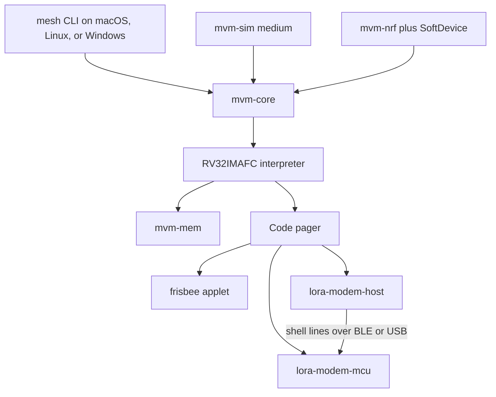

# Mesh Virtual Machine

Greenfield Rust workspace. Instruction set is **RV32IMAFC** (`riscv32imafc-unknown-none-elf`, the hard-float `ilp32f` ABI, static relocation, `medany` code model). Single-precision floats are native instructions; doubles use software routines. The interpreter holds 32 registers; RV32E saves 64 bytes of register file and makes the compiler spill more, so it stays out unless code size later forces it.

This revision is the crate spec from the shared chat. Build order and verification live in [the implementation plan](implementation-plan.md). Each crate below says what it owns, what it exports, and the rules that came out of that discussion.

Left behind on purpose: a TinyGo kernel, wasm as the distribution format, a custom scripting language, MicroPython, guest chunk heaps, a granule ownership table, a global block registry with per-allocation entries, address generations, slot and slab references, heap compaction, per-page hashes, applet signing and a developer trust store, epidemic applet distribution and automatic upgrades, safe mode, remote recovery over LoRa (all in the icebox), Meshcore messaging and repeater applets, and copying applets into a second contiguous flash region.

## Locked decisions

- **North star: the kernel provides intrinsics, applets build everything else.** A name belongs in the kernel only if it needs hardware or a native stack, kernel state, native speed or timing the interpreter cannot meet, or is needed to boot and load applets. Everything else is an applet that registers names as a kernel extension. Responsibility has three layers:
  1. **Kernel.** Tied to hardware and the inbox: the VM, memory, names and calls, loading, drivers, the filesystem, the `config.*` meshops, failures and the syslog, one hardware alarm, the shell's plumbing, and the recovery core of shell commands.
  2. **Bootstrapper.** Fundamentals that are purely synthetic, built from SDK modules linked into `boot.mhc`: load policy, board bring-up, the event bus, timers, `sys.ready`, and the hardware shell (every shell command beyond the recovery core). The kernel relies on a small contract from it (see **Bootstrapper-provided names**).
  3. **Applets.** Every other feature and extension.

  The clearest case is events: **the kernel's whole event job is the inbox, then `evt.emit`.** It queues external events and hands each one to the `evt.emit` name, which the bootstrapper provides. Listener lists, ordering, filters, and hook policy all live in applets.
- **Trust model.** The node trusts its operator, and applets are trusted collaborators. Composition comes first, so applets may observe, wrap, and build on each other freely. In v1:
  - Any applet may read and write any other applet's memory, call every kernel function (including `sys.reboot`), layer middleware on any name, and read and write any file. There are no grants, capabilities, or signing. Applet isolation and signing are in the icebox.
  - The one guardrail is memory: per-applet `max_ram` and `reserved_ram` stop a buggy applet from taking every page.
  - Two things trap because there is nothing else sensible to do: an address in a page nobody mapped, and an access to the kernel's own pages outside the running call's stack, the I/O buffers assigned to it, and its event payload. The second keeps a stray applet pointer from corrupting the kernel or the management link.
  - Anything that goes wrong in an applet reboots the node: a trap, an event that runs past its instruction budget, or the hardware watchdog. The kernel logs what it can first. Nothing is disabled or blamed.
- Rust kernel. One image per MCU family. On nRF52840 that holds only if every board runs the same SoftDevice, or if the kernel links Nordic's SoftDevice Controller instead; the implementation plan checks this first (step 0.6). On ESP32-S3 the console runs on both USB-Serial-JTAG and UART0, so boards with native USB and boards with a USB-UART bridge reach the Mac without board facts. nRF52840 (WisMesh Tag, RAK4631, Heltec Mesh Node T096, XIAO nRF52840, and the solar repeaters: 256 KiB SRAM, 1 MB flash, SX1262) and ESP32-S3 (T-Deck Plus, Heltec V3 and V4, XIAO ESP32S3) are equal first-class targets from the first milestone. Both are verified at every milestone, and neither is a port of the other.
- Stock Adafruit UF2/CDC/DFU bootloader and Nordic SoftDevice stay. Kernel is an ordinary app at the SoftDevice's app address. Implementation step 0.1 found S140 6.1.1 (app at `0x26000`, about 152 KiB of SoftDevice) on the Tag, both RAK4631 boards, and the T096, and S140 7.3.0 (app at `0x27000`) on the XIAO nRF52840; step 0.6 settles the mismatch before the linker script freezes. EnvyBoot, the Adafruit fork on the Tag and the T096, counts as the stock bootloader. First install is copying `mvm.uf2`. Two resets inside 500 ms enter the bootloader. Kernel updates are bench-tested USB releases. A bad kernel image sits in DFU, which LoRa cannot reach. No A/B kernel slot in v1. Applet rollback is copying the previous `.mhc` back.
- SHA-256 and AES stay native host functions. The interpreter does not run them. A SHA-256 of an applet file's content is its content hash, which identifies a build.
- Users upgrade an applet by copying the new `.mhc` over the old one with `mvm cp`; rolling back is copying the old one back. Applet signing and automatic upgrades over the mesh are in the icebox.
- Networking is native on boards with Wi-Fi (the ESP32-S3 family, plus the simulator and Darwin through host sockets). The kernel runs the Wi-Fi driver and a TCP/IP stack and exposes non-blocking `net.*`, `dns.*`, `tcp.*`, and `udp.*` builtins that finish through per-request callbacks. Credentials live in the `[net]` section of `config.ini`. TLS is not in the first cut.
- The radio state machine stays native. Bytecode does packet logic. CAD, RX windows, airtime, and duty cycle do not depend on interpreter latency.
- The kernel starts the hardware watchdog at boot and feeds it from its scheduler loop, which catches kernel and native hangs. It exposes `sys.reboot` and `sys.resetReason`. Applets are never unloaded one at a time in v1: a trap, a blown event budget, replacing a loaded applet's file (see **Files in use**), and `mvm reboot` all reset the node, so no applet ever sees a neighbour vanish or come back with empty memory. To stop an applet, remove it from `[applets]` and reboot. A node whose applets trap on every boot keeps rebooting until it is fixed over USB or reflashed. A bootstrapper that fails falls back to the embedded default on the next boot (see **boot**). Safe mode, remote recovery, disabling applets that keep failing, and unloading without a reboot are in the icebox. A RAM syslog survives the reset (see **syslog**). There is no software watchdog service in v1. An applet that needs a liveness check runs its own timer, and the radio service detects a wedged radio itself.
- Applets are event handlers. They have no `main`. Every callback runs because of an external event: a radio frame, TCP data, a pin interrupt, a timer, a completion. External events wait in a kernel **inbox**. A **turn** is one external event and everything it sets off: its listeners, the calls they make, and the events they emit. The next turn starts only when the current one has finished.
- The VM runs in time slices counted in instructions. Each pass of the kernel's main loop runs at most `[kernel] instr_per_tick` guest instructions, then yields to the shell, the inbox, and the watchdog. The default is set from the measured interpreter speed (implementation step 2.8) so that one slice plus the slowest native call stays far below the watchdog timeout (8 s): a busy VM never trips the watchdog. Driver tasks run above the main loop at interrupt priority, so the radio and USB never wait for a slice. An unfinished turn resumes on the next pass. With nothing to do, the loop sleeps until an interrupt.
- A turn may run at most `[kernel] instr_per_event` guest instructions in all. Past that, the kernel logs which event failed to finish and resets the node. Instructions are counted, not wall-clock time, so budgets behave the same on every chip and in the simulator. Nothing is charged to a particular applet.
- v1 is not a realtime system. Turns run to completion one at a time, so an event waits for the turn ahead of it, including one held by a slow storage write (a driver polling a busy SD card). Events are never reordered and never lost except over a source's cap, where drops are counted; they may be late; 5.18 measures the worst delay. Signals that need microsecond timing (IR, quadrature encoders) belong to native code or the chip's peripherals, not the VM. Non-blocking I/O, an urgent lane, and preemptive guest contexts are in the icebox.
- Guest pointers are virtual: `[partition : 8 | offset : 24]`. Each applet's heap is its own partition, backed by 256-byte physical pages. Heap addresses are globally unique, so an applet can hand one to another and both see the same bytes. Pages are interchangeable, so there is no compaction. Node config gives each applet `max_ram` and `reserved_ram`. Both default to 0: no cap and nothing reserved. Kernel Rust allocations live in a separate pinned region. Loading an applet maps only its statics (`.data` copied from the `.mhc`, `.bss` zeroed), once, before `init`. Both limits include the statics. The rest of a reservation is set aside, not mapped. No heap, arena, or stack is set aside per applet: the heap starts empty and grows a page at a time, and stack pages exist only while a callback runs. This is the opposite of a wasm-style reserved linear memory, and the implementation plan's drift guards G1 to G5 test it permanently.
- Code is demand-paged through a `Code` reader. Virtual contiguous image, 512-byte pages, and one shared cache of page slots that the kernel sizes from the RAM and PSRAM it detects (`[kernel] code_cache_kb` overrides): a few slots on nRF52840, enough on an ESP32-S3 (in PSRAM where the board has it) that most applets stay cached after their first run. Loaded applets may live on any mount, including ones an applet provides (`/sd`, `/extra`). A code-page miss on such a mount is an implicit call to the page fill: littlefs calls the driver's `read` as a nested guest call, the page lands, and the fetch is retried (nothing had executed). Three rules make that safe: applets that serve a mount (block devices and filesystem providers), and any applet layering middleware on a name a driver calls during I/O (`spi.transfer`, `qspi.cmd`, `log.write`, the driver's own verbs), live on `/boot`, along with `boot.mhc`, and every other applet may live anywhere (a policy, not checked by the tools or the loader; if it is broken and a fill needs another fill to finish first, that code-page miss traps, which logs it and reboots); the cache slot being filled is reserved until the fill completes, so the driver's own fetches cannot evict it; and a replacement's held changes land after the last turn as nested provider calls (see **Files in use**), so a file on such a mount can still be renamed into place. Guest code is never copied into RAM. The one exception is an image that fits in a single 512-byte code page, which may run from RAM and counts against that applet's pages. RAM for code is the shared slot cache, fixed per board, whatever the number and size of applets. Drift guards G6 and G7 test this permanently.
- The VFS is built on providers. The kernel ships littlefs2 and a block device for each internal flash partition, and mounts `/boot` as littlefs2 on the `boot` partition. Applets can provide block devices (the kernel runs littlefs2 on them) or whole filesystems, and can mount them from `init` with no node config. Installing an applet is copying its `.mhc` to the node (`mvm cp`, or a text editor and Finder through `mvm mount`) and listing it in `[applets]`. There is no install step and no protected code store: a user who installs an applet trusts it. The filesystem feels like old-school DOS: every applet, and the user through `mvm`, may read and write any path on any mount, including `/boot/config.ini`. There are no mount grants, per-applet directories, or quotas. The only check on code is the loader hashing it at load.
- Boot policy is an applet. After mounting `/boot` and starting the management service, the kernel loads `/boot/boot.mhc`. The kernel image embeds a default bootstrapper and writes it to `/boot/boot.mhc` on first boot and whenever the file is missing, so the file on `/boot` is always what governs boot. The default reads the `[applets]` section of `/boot/config.ini` and loads exactly those instances, in exactly that order. Nothing else is loaded. A custom `boot.mhc` can boot any way it likes. The management service starts before `/boot/boot.mhc` and needs no applet, so a bad bootstrapper or applet can be fixed over USB; a failed bootstrapper falls back to the embedded default.
- One kernel image per MCU family serves every board. Board facts are semantic names in the `[board]` section of `config.ini`, usually from a board preset. The kernel boots any board with safe defaults, and USB, BLE, `/boot`, and the management service need no board facts. The radio stays off until its wiring probes correctly and `radio.max_dbm` is set.
- `config.getStr`, `config.getI32`, and `config.getBool` read any value from any section of `config.ini` by dotted name, with a default given at the call site; matching `config.set*` meshops write it. An applet's settings live in the section named after its instance. The config meshops are kernel builtins that the bootstrapper or a config applet can layer on or replace.
- Host calls never block on a transport. A call that finishes later (`radio.tx`, `dns.resolve`, `tcp.connect`, a timer) takes a callback and a `ctx` word, returns at once, and the kernel later calls `callback(ctx, …)` for that request only. A resource an applet opens (a UART, a pin interrupt, a BLE link or scan, a socket) delivers its traffic to the callback passed when it was opened, for that applet only. Events (`evt.on`) are for broadcasts anyone may care about, such as `radio.rx`, `net.up`, `sys.ready`, and `mem.low`, plus the read-only transport taps `tap.rx` and `tap.tx` that let an applet observe traffic it does not own. Stackful suspension is out. The SDK offers `async`/`await` on top of callbacks, as stackless futures in the applet's own memory.
- The only applet export is `init`. The kernel calls it after that applet is loaded. Every host call is `mesh(name, ...)`, and every name is `scope.verb`. Anything callable through `mesh()` is a **meshop**: a kernel meshop (a builtin) or one an applet registers with `sys.register`. From `init` the applet may `mesh("evt.on", event, callback, ctx)` (provided by the bootstrapper, which has already loaded), `mesh("time.setTimeout", msec, callback, ctx)` (also the bootstrapper's), `mesh("sys.register", "custom.myFunc", handler, ctx)`, and call builtins such as `mesh("radio.tx", ...)` immediately. It does not have to wait for `sys.ready`. The bootstrapper emits `sys.ready` once every load it queued has run `init`, so every applet it loaded has run `init` and every `mesh("sys.register", ...)` from those calls is installed. From `init` an applet may call kernel builtins, the bootstrapper-provided names, and names registered by applets listed before it. It listens for `sys.ready` only when it needs a name from an applet listed after it. The Rust SDK wraps these. The wrappers are not extra host entries.
- Overriding a name is middleware. Each name has a stack: the provider at the bottom (a builtin or the first applet to register it), and layers above in registration order. A call goes to the top layer, and a layer passes the call down with `mesh("sys.next", name, …)`, which reaches the layer directly below its own. There is no copy of the old provider under a new name, so nothing can bypass a layer.
- The CLI is `mvm`. Its complete command list is the table under `apps/mvm`.
- An applet is one `.mhc`. The simulator, Darwin, and the tag all run that file inside MVM. Applet source is not recompiled into a native host program for tests.
- An applet may do anything the trust model above allows, and it does not declare which names it registers or which hardware it uses. A call to a name nobody provides fails with `ERR_UNAVAILABLE`. Pins and buses are shared, not claimed. The kernel refuses only the resources it owns, and it logs conflicting pin use between applets. An applet may mount at any unused top-level path except `/boot`.

**Logging is text.** Applets log with `log.printf(fmt, args…)` or `log.write(text)`. Formatting is a native kernel meshop (`fmt.sprintf`), so applets never link `core::fmt` or a C `printf`, and the log is readable anywhere: `mvm log`, `mvm tty`, or any serial terminal.

## Address map

A guest address is `[partition : 8 | offset : 24]`. Each partition is a 16 MiB virtual space, and physical RAM backs it in 256-byte pages. This replaces the chat's single global block registry, address generations, and heap compaction. A misbehaving applet can fragment only its own partition. Any free physical page can back any virtual page, so physical RAM never needs compacting.

| Partition | Contents | Who resolves it |
| --- | --- | --- |
| `0x00` | Never mapped, so a null dereference traps. Applets are linked with `0x00` as a placeholder partition byte; the loader replaces it (below). | Nobody. |
| `0x01` | Reserved. | Nobody. |
| `0x02` | Kernel partition: the kernel reserve, one contiguous block of RAM mapped linearly (offset N is byte N of the block), so native code and guest code see the same bytes at the same place. It holds the guest stack (at offset 0), the inbox ring, and a small I/O scratch area. | The running call chain reads and writes the guest stack and any I/O buffer assigned to it, and reads its event payload. Any other access traps. |
| `0x03`–`0xFF` | Two partitions per loaded applet, assigned at load. The **image partition** holds code at offsets `0x01_0000`…, paged from storage by `mvm-code` (execute), and statics (`.rodata`, `.data`, `.bss`) at offsets `0x80_0000`…, mapped at load and charged to the applet (read and write). The **heap partition** holds what `mem.malloc` returns. | Every applet and the kernel. Only the owner's `mem.*` calls allocate and free in its heap. |

- **One shared address space.** Every address means the same bytes to every applet and to the kernel, including code, constants, and statics. A string literal, a static buffer, or a function address can be passed to any applet.
- **How an image works at any partition.** Applets are compiled with the `medany` code model, so code reaches its own functions, constants, and statics with PC-relative instructions (`auipc` plus an offset). Code and statics share one partition, so those distances never change, and an image runs wherever its partition is.
- **Absolute pointers stored as data are relocated.** Vtables, tables of `&str`, and statics holding pointers are written by the linker as absolute 32-bit words with the placeholder partition byte. The packer lists their offsets in the `.mhc`, and the loader replaces the top byte with the image partition once at load. Every such word is in statics (rodata included), so code pages are never patched when filled. The file on flash is never changed.
- **Constants live in RAM.** Rodata is part of the statics, loaded with them and charged to the applet, so only instruction fetches go through the code cache. A data load, including one made by native code reading a guest buffer, never fills a code page. Large constant data (fonts, tables, bitmaps) belongs in a file next to the applet, read with `fs.read`, not embedded.
- About 126 applets fit in the partition ids, which is far more than RAM allows.
- Image and heap partition ids are assigned at load. Applets are never unloaded while the node runs, so ids are never reused before a reset.
- There is one guest stack, `[kernel] stack_size` bytes in the kernel partition, shared by every applet. Only one call chain runs at a time, so one stack is enough. A callback starts with `sp` at the top. A nested call continues down the same stack from the caller's `sp`, like an ordinary function call, under a depth cap (`[kernel] call_depth`) that stops runaway recursion between applets. Applets declare no stack size. The stack sits at the bottom of the kernel partition, so the never-mapped partition `0x01` is a large gap below it, and an overflow, whether from many frames or one large one, traps on its first access, which is logged with the running applet. The kernel tracks the high-water mark, and `mvm ps` shows it so `stack_size` can be tuned. `ra` starts as a sentinel outside the code window, so `ret` ends the handler. On switch, zero the used portion up to the high-water mark.
- The kernel is outside the guest space. Host functions take guest pointers and walk them page by page, because consecutive virtual pages are not consecutive in RAM. Native code does not hold a physical page pointer across an event, because that page may be unmapped and reused by another partition. The one exception is a littlefs cache buffer passed to `fs.mount`: it comes from `mem.cmalloc`, littlefs holds it for as long as the mount lasts, and the driver keeps it allocated while mounted. DMA and radio FIFO buffers come from the pinned kernel region, outside the page pool.

Physical RAM after the kernel's statics is split at boot into a pinned kernel region (kernel Rust allocations, DMA and radio buffers) and the page pool. On the tag, about 128 KiB of pool is 512 pages.

An aligned access never crosses a 256-byte page. A misaligned load or store instruction traps, and so would a straddling one, since only a misaligned access can straddle. `riscv32imafc` does not promise fast misaligned access, so the compiler lowers `read_unaligned`, packed-struct fields, and `memcpy` of odd-sized data to byte accesses. Only undefined behaviour, such as casting an odd address to `uint32_t *` in C, produces a misaligned instruction. Ordinary and unmodified code therefore never hits this trap, and nothing in the SDK is banned for it. `addr + len` uses checked add.

## Workspace

```text
mvm/
  crates/mvm-abi/
  crates/mvm-sdk/
  crates/mvm-mem/
  crates/mvm-code/
  crates/mvm-vm/
  crates/mvm-core/
  crates/mvm-hal/
  crates/mvm-sim/
  crates/mvm-packer/
  apps/mvm/
  apps/mvm-nrf/
  apps/mvm-esp32s3/
  applets/boot/
  applets/frisbee/
  applets/hello/
  applets/stats/
  applets/chaos/
  applets/lora-modem-proto/
  applets/lora-modem-host/
  applets/lora-modem-mcu/
  applets/extra-fs/
  applets/sd/
  applets/fat/
  applets/tests/
  tests/guards/
  scenarios/
  xtask/
  docker/
  fuzz/mvm-mem/
  profiles/
  changelog/
```

`applets/tests/` holds the purpose-built test applets, `tests/guards/` the drift-guard tests, `scenarios/` the `mvm run` scenarios, `xtask/` the repo tooling (`cargo xtask bench`, `cargo xtask guards`, `cargo xtask release`), `docker/` the two builder images (`docker/firmware-builder/` and `docker/applet-builder/`), and `changelog/` the changelogs of the `firmware`, `sdk`, `mvm`, and `firmware-builder-image` release units (see Releases).

Names: *firmware* is only ever what goes on a board (the kernel's `.uf2` and `.bin`); a *builder* is a Docker image holding compilers. Kernel firmware is built in the pinned firmware builder image (`benallfree/mvm-firmware-builder`), like applets are built in the applet builder image (`benallfree/mvm-applet-builder`): Espressif's Rust toolchain for the ESP32-S3's Xtensa cores next to stable Rust for nRF52840, so every machine and CI builds identical kernels. Flashing runs on the host with pinned `espflash` and `probe-rs`, because containers on macOS cannot reach USB devices.

An applet never links an MCU HAL. Kernel crates never link applet game logic.

## Releases

Each release unit has its own semver version, its own changelog, and its own tag, `<unit>-vX.Y.Z`, published as a GitHub Release with the artifacts and that version's changelog section as its notes. A release's title is `<unit> <version>`, and its notes open with the unit's one-line tagline in italics (for example *Docker image that builds MVM kernel firmware*); an applet's tagline is the description in its `mvm.toml`.

| Unit | Contents | Changelog | Each release states |
| --- | --- | --- | --- |
| `firmware` | The firmware to flash: the kernel plus the embedded `boot.mhc`, built by the firmware builder, as `mvm-firmware-<version>-nrf52840.uf2` and `mvm-firmware-<version>-esp32s3.bin`, plus the board presets | `changelog/firmware.md` | Its component versions: kernel, `boot`, `firmware-builder-image`, and ABI |
| `boot` | The bootstrapper applet, `boot-<version>.mhc`, for updating `/boot/boot.mhc` without reflashing | `applets/boot/CHANGELOG.md` | Its `min_abi` |
| `sdk` | `mvm-abi`, the Rust and C SDKs (`mvm-sdk` and the C runtime), `mvm-packer`, and the applet builder image, pushed to Docker Hub as `benallfree/mvm-applet-builder:<version>` | `changelog/sdk.md`, with Rust and C sections | The ABI version it targets |
| `firmware-builder-image` | The Docker image that builds kernel firmware, pushed to Docker Hub as `benallfree/mvm-firmware-builder:<version>` | `changelog/firmware-builder-image.md` | Its multi-arch digest and its pinned tool versions (`docker/firmware-builder/versions`) |
| `mvm` | The CLI for macOS, Linux, and Windows | `changelog/mvm.md` | |
| Each shipped applet (`frisbee`, `stats`, `extra-fs`, `sd`, `fat`, the `lora-modem-*` applets) | Its `.mhc` | `applets/<name>/CHANGELOG.md` | Its `min_abi`, and a kernel version when it needs a kernel fix (advice only) |

- The ABI version is `mvm-abi`'s version (see `crates/mvm-abi`). It has no release of its own: an ABI change ships in an `sdk` release and in the `firmware` release whose kernel implements it. Applets depend on the ABI, never on a kernel version, and find features with `sys.has`.
- The kernel (`mvm-core`, the HAL backends, and the firmware apps) has its own semver, which `sys.version` reports, but no release of its own: it only ships inside `firmware`. `boot` releases on its own (nodes update by copying the `.mhc`), and the next `firmware` release embeds it. `applets/tests` never ships.
- A `firmware` release follows anything that changes its firmware bytes: a kernel change, a new `boot` embedded, or a new `firmware-builder-image`. Builds are reproducible, so the test is concrete: rebuild and compare with the last release's bytes. Its version bump is the largest of its parts' bumps (a compiler-only rebuild is a patch), and its notes list the component versions, for example `kernel 0.2.1 · boot 0.4.0 · firmware-builder-image 0.1.0 · ABI 0.2.0`.
- Versions follow semver: major for a break in what users, applets, or other nodes rely on (an applet's settings, the names it registers, its wire format), minor for additions, patch for fixes. Before 1.0, a break bumps the minor.
- Images are multi-arch (`linux/arm64` and `linux/amd64`) and are always used by digest, never by tag: `docker/firmware-builder/digest` holds the firmware builder's, and `mvm` holds each SDK release's applet builder. A builder image is built on the Mac and pushed per platform (`<version>-arm64`, `<version>-amd64`), then joined into the multi-arch `<version>`. An image's version follows its effect on what it builds: patch for a rebuild with the same tool versions whose output is byte-identical, minor when any tool version changes, major when the way it is invoked changes.
- Every change lands with an entry under "Unreleased" in the changelog of each unit it touched. A release, run with `cargo xtask release <unit> <major|minor|patch>` on a clean, up-to-date `main`, bumps the version, moves those entries under the new version and date, commits, tags, and pushes; a `firmware-builder-image` release also pushes the image first. CI then builds the unit and publishes the GitHub Release, marked as a pre-release while the version is `0.0.x`.
- Versions live in: `apps/mvm/Cargo.toml` (`mvm`); `apps/mvm-nrf` and `apps/mvm-esp32s3` (`firmware`, kept equal); `crates/mvm-core` (the kernel version, bumped by hand when kernel code changes); `applets/boot/mvm.toml` (`boot`); `crates/mvm-sdk` and `crates/mvm-packer` (`sdk`, kept equal); `docker/firmware-builder/versions` (`firmware-builder-image`). The ABI version is `crates/mvm-abi`'s, bumped by hand when names or layouts change.
- `mvm` ships as `mvm-<version>-<target>.tar.gz` (`.zip` on Windows) for `aarch64-apple-darwin`, `x86_64-apple-darwin`, `x86_64-unknown-linux-gnu`, `aarch64-unknown-linux-gnu`, and `x86_64-pc-windows-msvc`, with a `SHA256SUMS` file. A `firmware` release attaches the `.uf2` and `.bin`; from 0.7 the ESP32-S3 file is a merged image (bootloader, partition table, and app) that flashes a blank board in one go.

## crates/mvm-abi

Shared `no_std` types for the kernel, the packer, the SDK, and every applet. This is the only crate both sides depend on, so names cannot drift.

- **Names and versions.** The two tables below are the complete kernel `mesh` name list and the complete kernel event list. A breaking change is a new name, so two providers can coexist. Manifests carry no `provides` or `requires` lists. The name table at run time is the only record of who provides what.
- **Versions.** There are three version numbers, all semver.
  - The *kernel version* tracks the kernel's implementation: drivers, board presets, performance, and management commands. Many kernel changes change nothing an applet can see.
  - The *firmware version* is the `firmware` release's (see Releases): the kernel plus the embedded bootstrapper, as built by a given firmware builder.
  - The *ABI version* is the version of this crate, because this crate is the applet contract: names, byte layouts, the return convention, and the `.mhc` format. A minor bump adds names or layouts. A patch bump fixes docs or tests. There is no major bump, because a breaking change is always a new name or a new layout.
  - The kernel reports all three through `sys.version`. The packer records the ABI version the SDK built against in the manifest.
  - Applets detect features with `sys.has(name)`, not by comparing versions, because applets provide names too. The ABI version is for layouts, diagnostics, and the optional `min_abi` load check.
- **Dispatch.** One host entry, `mesh(name, ...)`. `ecall` always lands there. The name is a guest string `(ptr, len)`, checked like any other load, then looked up. Every name is `scope.verb`, including names an applet registers. The rest of the arguments arrive as a guest array of `u32` words with its count, so variadic calls (`sys.next`, `evt.emit`, `log.printf`) can forward them. Every string or buffer argument is two words, `ptr, len`; strings are not NUL-terminated. Two exceptions take one word: an out pointer to a fixed `mvm-abi` layout (`time.now`, `sys.version`, `mem.stat`, `fs.stat`, and the like), and a buffer whose length another argument already gives (the shared `len` of `spi.transfer`, the output of `crypto.aes`, which is as long as its input). An argument marked optional is passed as 0 (or 0, 0), never left out, so positions never shift. Builtins and names published with `mesh("sys.register", "custom.myFunc", handler, ctx)` share that table. An applet calls a function that did not exist at compile time with `mesh("custom.myFunc", ...)`. There is no per-function ecall immediate, no FNV import hash, and no `.mesh.imports` section. Code in flash stays immutable. The name list is the host-call table below.
- **Return convention.** Every `mesh` call returns two words: a status in `a0` and a value in `a1`, which is how the RISC-V calling convention already returns a pair. Status 0 is success, and anything else is a stable error code. The value is only meaningful on success, so the full 32 bits are free for addresses, lengths, and ids. The SDK wraps the pair as `Result<u32, Error>`, and the C runtime's `malloc` turns an error into `NULL`. A call never traps because a name is missing or a provider is gone. It returns `ERR_UNAVAILABLE`.
- **Exports.** The only required export is `init`. The packer checks that symbol. Callbacks passed to `mesh` calls (listeners, timers, registrations, and completion callbacks) are function pointers into the code window. They are not ELF exports and they are not listed in the manifest.
- **Events.** `evt.on` and `evt.emit` are not kernel builtins. The bootstrapper provides them (see **Bootstrapper-provided names** below). `mesh("evt.on", name, callback, ctx)` subscribes. `mesh("evt.emit", name, ...)` runs the subscribers for that name at once, inside the current turn, and returns when they have all returned. The kernel emits its own events by calling the same `evt.emit`. Timers are the bootstrapper's too: `mesh("time.setTimeout", msec, callback, ctx)` arms a one-shot timer that calls `callback(ctx, 0, 0, timer id)`, multiplexed over the kernel's single `time.alarm`. A repeating period is the callback arming the next timeout. `mesh("sys.register", "custom.myFunc", handler, ctx)` publishes that name, so other applets call `mesh("custom.myFunc", ...)`.
- **`sys.ready`.** Emitted once by the bootstrapper, through the bus, after every load it queued with `sys.load` has run `init` (each `sys.load` completion tells it). By then every `mesh("sys.register", ...)` from those calls is in the name table. Listening is optional. Loads run one at a time in `[applets]` order, so a name registered in the `init` of an applet listed earlier is already usable from a later applet's `init`. `sys.ready` is only for names registered by applets listed later, or by a custom bootstrapper that loads in another order. An applet loaded after that point runs `init`, and the default bus calls a `sys.ready` subscriber at once when it subscribes after ready, because the system is already up.

### Kernel calls

These are the kernel meshops. Every name is `scope.verb`. The kernel installs these. An applet cannot replace a locked one: `sys.register` of a locked name returns `ERR_DENIED`. Unlocked ones may be layered on or replaced, and on a profile without the hardware an applet may provide the name itself (as `lora-modem-host` provides `radio.tx` on Darwin). A device call is installed only when the hardware is present: the radio meshops only after a successful `radio.attach`. `sys.register` on a name that already has a provider pushes a middleware layer on it, as described under Middleware. A call to a missing name returns `ERR_UNAVAILABLE`. Calls return their status and result in the call, as described under Return convention. Calls that finish later take a callback and a `ctx` word, as described under Completion callbacks.

| Name | Locked | Arguments and result |
| --- | --- | --- |
| `sys.sleep` | yes | microseconds. Pauses the current turn in place for at least that long, the same way a time slice ends, then returns. At interpreter nesting level 1 or more (see `mvm-vm`), the turn cannot pause, so `sys.sleep` waits in place instead, idling the CPU and feeding the watchdog. That costs nothing extra: only an applet's own turn, or a kernel-started call while no turn is running, can reach an applet-driven littlefs, so everything else that could run (other turns, shell lines) is already waiting in the inbox, and the kernel's native work uses its own littlefs instances. It never traps, so a driver's busy-wait code is the same wherever it runs. A time slice that ends at level 1 or more feeds the watchdog and carries on until the level drops back to 0. At level 0, while the turn is paused, the main loop keeps running (shell, watchdog, drivers) and the CPU may sleep, but no other turn starts, so inbox events wait. Sleeping is not counted toward `instr_per_event`. This is how a driver applet waits out a chip's busy period: it polls with its own chip-specific check and sleeps between polls. |
| `time.now` | yes | out pointer. Writes the time since boot in microseconds as a 64-bit value (two words). |
| `time.alarm` | yes | deadline (64-bit µs, two words), callback, ctx. Arms the node's one hardware alarm; a new call replaces the previous one, and a deadline of 0 cancels it. Calls `callback(ctx, 0, 0)` as its own turn. By convention the bootstrapper owns it and multiplexes timers over it. |
| `sys.register` | yes | name, handler, ctx. Publishes a new `scope.verb` name, or pushes a middleware layer on an existing one (see Middleware). A call to the name runs `handler(ctx, argp, argc)` in the registering applet, where `argp` points to the caller's argument words (global, so readable) and `argc` is their count; the handler returns status and value in `a0` and `a1` like a builtin. |
| `sys.next` | yes | name, then that name's arguments. Calls the layer directly below the caller's own layer on that name. Only an applet with a layer on that name calls it. The original caller is preserved: the layers below and the bottom provider act on behalf of the applet that made the first call. |
| `sys.caller` | yes | none. Returns the calling applet id: through `sys.next`, the applet that made the original call; for a call the kernel makes itself (`evt.emit` for an inbox event, `tty.exec` for a shell line), 0. |
| `sys.self` | yes | out ptr, len. Writes the running applet's own instance name and returns its length. |
| `sys.version` | yes | out pointer. Fills the version layout: firmware version (major, minor, patch), kernel version (major, minor, patch), ABI version (major, minor, patch), build hash, MCU family, the detected part (and, where readable, the bootloader's board id), and a unique 64-bit device id (nRF FICR DEVICEID, the ESP32-S3 eFuse MAC, or the scenario's node id on a host node). Applets such as frisbee use it as their node id. |
| `sys.names` | yes | out ptr, len, cursor. Lists the name table a page at a time: each name, its provider (builtin or applet), and its middleware layers from top to bottom. Returns the next cursor, 0 at the end. |
| `sys.has` | yes | name. Returns whether the name is provided, and by what (builtin or applet, and the number of middleware layers), without calling it. |
| `sys.resolve` | yes | callback reference (two words: function address and `ctx`), then `ptr`, `len` (0 and 0 if no buffer), then the callback's scalar words. Calls the referenced callback at once, nested on the shared stack, as `callback(ctx, ptr, len, words…)`, and returns when it returns. The kernel checks that the address lies in that instance's code window and traps otherwise. |
| `sys.reboot` | yes | reason word. Stores the word in retained RAM. When the current turn ends, the kernel emits `sys.rebooting` and then resets the node. |
| `sys.resetReason` | yes | out pointer. Fills the hardware cause of the last reset (power-on, reset pin, watchdog, software, brownout) and the reason word, if any: an applet's `sys.reboot` word, or the kernel's own `trap`, `budget`, `replace`, `reboot`, or `boot_failed`. |
| `sys.load` | yes | path, instance name, extra ptr, extra len. Queues a load. The queue runs in call order after the caller's callback returns, so a loaded applet's `init` never nests inside the caller. The instance's settings come from its `config.ini` section. Optional `extra` is `key=value` text a custom bootstrapper layers on top: the `config.*` meshops overlay those keys on that instance's section, and the kernel's `max_ram` and `reserved_ram` read honours them. The kernel applies `max_ram` and `reserved_ram` itself. Optional callback and ctx (pass 0 and 0 for none; the default bootstrapper passes one): called as `callback(ctx, 0, 0, status)` exactly once per load: with status 0 after its `init` and queued mounts finish, or with the error code if the load is refused (a missing file, a torn file, a `min_abi` newer than the kernel's, or no room), which is how the bootstrapper knows when to emit `sys.ready`. Any applet may call it. |
| `mem.malloc` | yes | size, alignment (a power of two; 0 means 8). Returns an address in the caller's heap partition. Allocations of a page or more start on a page boundary. |
| `mem.cmalloc` | yes | size. Like `mem.malloc`, but page-aligned and backed by physically adjacent pages, mapped when it is called, so native code can treat it as one unbroken block. Freed with `mem.free`, and counted against `max_ram` like any allocation. For buffers native code holds, such as littlefs caches passed to `fs.mount`. |
| `mem.free` | yes | pointer. 0 is a no-op. Any other pointer outside the caller's heap partition traps. A bad pointer inside it can damage only that partition. |
| `mem.realloc` | yes | pointer, size. Returns the new address, which may differ. Pointer 0 acts like `mem.malloc`. Same pointer rule as `mem.free`. |
| `mem.stat` | yes | out pointer. Writes the 32-byte memory snapshot below. |
| `crypto.sha256` | yes | ptr, len, out pointer. Writes 32 bytes. |
| `crypto.aes` | yes | mode (`ecb` or `ctr`), key ptr, key len (16 or 32 bytes: AES-128 or AES-256), iv ptr, iv len (16 for CTR; 0, 0 for ECB), in ptr, in len, out ptr, direction. ECB takes whole 16-byte blocks. |
| `log.write` | no | ptr, len. Appends one line of text to the syslog ring. The kernel prefixes the time since boot and the caller's instance. |
| `log.printf` | no | format ptr, len, then arguments. Formats like `fmt.sprintf` straight into the syslog ring. |
| `fmt.sprintf` | no | out ptr, len, format ptr, len, then arguments. Native `snprintf`: `%d %u %x %c %s %f` with width, padding, and precision (`%s` takes two words, a global pointer and a length; `%f` one single-precision word; the C `printf` shim narrows each promoted `double` to one `float` word). Writes the text and returns its full length, so a short buffer can be retried. Not locked: an applet may layer on it to change formatting. |
| `radio.attach` | no | radio index, chip, wiring ptr, len. The wiring is the `mvm-abi` layout of pin specs (SCK, MOSI, MISO, NSS, reset, BUSY, DIO1, and the RF switch: DIO2, or RXEN and TXEN), TCXO voltage, regulator mode (LDO or DC-DC), and `max_dbm`; the PA configuration follows from the chip and `max_dbm`. Resets and probes the chip and returns ok or an error; on success the other `radio.*` meshops are installed and power is clamped to `max_dbm` from then on. The bootstrapper calls it once. |
| `clock.lfxo` | no | none. Switches the low-frequency clock to the external 32 kHz crystal. nRF52840 only. |
| `power.dcdc` | no | none. Switches the core regulator from LDO to DC/DC. nRF52840 only. |
| `radio.status` | no | radio index, out pointer. Fills the attached chip, current settings, TX queue depth, duty-cycle use, and RX, drop, and wedge counters. |
| `radio.config` | no | radio index, frequency, spreading factor, bandwidth, coding rate, power, sync word, preamble. Power is clamped to the `max_dbm` given to `radio.attach`. The radio has one configuration: the last call wins, is logged, and queues `radio.configured`, which runs as its own turn after the current one. Receive is on continuously between transmits once configured. |
| `radio.tx` | no | radio index, ptr, len, policy, callback, ctx. Returns a tx id. Policy is listen-before-talk and airtime class. Calls `callback(ctx, 0, 0, tx id, status, airtime_us)`, where status is `ok`, `duty`, `busy`, `cancelled` (the radio aborted it, for example during wedge recovery), or `dropped` (a middleware layer decided not to send it). |
| `config.getStr` | no | name, out ptr, len, default ptr, default len. Writes the value, or the default if the key is missing, and returns its length; a length larger than `len` means it was cut short. |
| `config.getI32` | no | name, default. Returns the value as a signed 32-bit integer: decimal, `0x` hex, or a size suffix (`4k`, `1M`). Missing or invalid returns the default (an invalid value is logged once). |
| `config.keys` | no | section, out ptr, len, cursor. Lists the keys of one section a page at a time. Returns the next cursor, 0 at the end. |
| `config.getBool` | no | name, default. `true`/`false`, `yes`/`no`, `1`/`0`; missing or invalid returns the default. |
| `config.setStr`, `config.setI32`, `config.setBool` | no | name, value. Rewrites that one line of `/boot/config.ini` in place, or adds the key (and its section) if missing, keeping comments and order. Readers see the new value at once; settings the kernel reads only at boot take effect after a reboot. |
| `fs.mount` | no | path, filesystem (`littlefs` or a provider scope), device (a block-device name, or empty), flags (`read_only`, `format_if_blank`), and for `littlefs` on an applet block device the cache buffer (pointer, length) and cache size, described under Block devices. Queued until `init` returns when called from `init`. |
| `fs.unmount` | no | path. Syncs the tree, then detaches it. |
| `fs.opendir` | no | path. Returns a directory handle. |
| `fs.readdir` | no | directory handle, out pointer. Fills the next directory entry; returns 0 at the end. |
| `fs.closedir` | no | directory handle. |
| `fs.open` | no | path, mode. Returns an fd. |
| `fs.close` | no | fd. |
| `fs.read` | no | fd, ptr, len. Returns bytes read. |
| `fs.write` | no | fd, ptr, len. Returns bytes written. |
| `fs.seek` | no | fd, offset, whence. Returns the new offset. |
| `fs.stat` | no | path, out pointer. |
| `fs.rename` | no | from path, to path. Atomic on littlefs. |
| `fs.remove` | no | path. |
| `fs.mkdir` | no | path. |
| `fs.sync` | no | fd, or 0 for every tree the caller has open (fds start at 1). |
| `fs.format` | no | path of a mount point. Wipes and re-creates the filesystem on that tree's device. The only call that erases existing data. |
| `fs.statfs` | no | path, out pointer. Total and free bytes of that tree. |
| `qspi.open` | no | bus pins (`sck=…,csn=…,io0=…`…`io3=…`), optional label. Returns a bus id. A name such as `qspi.flash` is resolved by the bootstrapper's layer. |
| `qspi.cmd` | no | bus id, opcode, address, tx ptr, tx len, rx ptr, rx len. One flash command. |
| `gpio.configure` | no | pin spec (a raw pin such as `P1.03`; a `[board]` name such as `led.red` is resolved by the bootstrapper's layer), optional label, direction, pull, drive, irq edge, callback, ctx. Returns a pin id for the other `gpio` calls. With an edge and a callback, edges are delivered as `callback(ctx, ptr, len, pin id)`, where `(ptr, len)` is a list of 8-byte entries, each a `u32` microsecond timestamp and a `u32` level, in the order the edges happened. Every applet that configured the pin with a callback is called. A kernel-owned pin returns `ERR_DENIED`. |
| `gpio.read` | no | pin id. Returns the level. |
| `gpio.write` | no | pin id, level. |
| `gpio.map` | no | out ptr, len, cursor. Lists the pin map a page at a time: each pin and bus, the label it was opened with (the `[board]` name, when the bootstrapper's layer resolved one), and which applets configured it, with conflicts flagged. Returns the next cursor, 0 at the end. |
| `i2c.open` | no | bus pins (`sda=…,scl=…`), optional label. Returns a bus id shared by every applet that opens the same pins. A name such as `i2c.qwiic` is resolved by the bootstrapper's layer. |
| `i2c.transfer` | no | bus id, address, tx ptr, tx len, rx ptr, rx len. Returns in the call. |
| `spi.open` | no | bus pins (`sck=…,mosi=…,miso=…,cs=…`), optional label. Returns a bus id; applets with different `cs` pins on the same bus share it. A name such as `spi.sd` is resolved by the bootstrapper's layer. |
| `spi.configure` | no | bus id, clock Hz, mode. Sets the clock and mode for the caller's transfers on that bus. The kernel reapplies each caller's settings before its transfers, because the bus is shared. |
| `spi.transfer` | no | bus id, tx ptr, rx ptr, len, flags. With `hold`, chip select stays asserted after the transfer, until the caller's next transfer without `hold` or the end of the callback. Returns in the call. |
| `uart.open` | no | port spec (`tx=…,rx=…,baud=…` on a board; `path=<device>`, or `usb_serial=<SERIAL>` that the host HAL resolves to the device carrying that USB serial number, on a host node), optional label, callback, ctx. Returns a port id. A name such as `uart.gps` is resolved by the bootstrapper's layer. Received bytes call `callback(ctx, data ptr, len, uart id, rx)`. On a host node, where the port is a USB serial device that can disappear, the callback also gets `down` when it goes away and `up` when the host HAL has reopened it by `usb_serial`. |
| `uart.read` | no | uart id, ptr, len. Returns bytes already buffered and not yet delivered to the callback. |
| `uart.write` | no | uart id, ptr, len. Returns bytes accepted. |
| `adc.open` | no | input pin (raw; a name such as `adc.battery` is resolved by the bootstrapper's layer), optional label. Returns an input id. |
| `adc.read` | no | input id. Returns the sample. |
| `ble.status` | no | out ptr, len, cursor. Fills advertising and scanning state, then lists the open links with their peers a page at a time. Returns the next cursor, 0 at the end. |
| `ble.advertise` | no | payload ptr, len, callback, ctx. Starts advertising as a connectable peripheral. Each accepted connection calls `callback(ctx, 0, 0, link id, accept)`, and that link then reports `rx` (`callback(ctx, data ptr, len, link id, rx)`) and `down` to the same callback, the way `tcp.listen` does. |
| `ble.scan` | no | callback, ctx. Starts scanning. Each advertisement calls `callback(ctx, adv ptr, len, rssi_dbm)`, where the buffer is the `mvm-abi` advertisement layout: the address, then the advertising data. |
| `ble.stop` | no | none. Stops the caller's scan and advertising. |
| `ble.connect` | no | address ptr, len, callback, ctx. Returns a link id. Calls `callback(ctx, ptr, len, link id, kind, …)` until the link closes: kind `up`, `rx` (with the data as `ptr, len`), or `down` (with a reason: `remote`, `timeout`, or `local`). |
| `ble.disconnect` | no | link id. |
| `ble.write` | no | link id, ptr, len. Returns bytes accepted. |
| `tty.exec` | no | channel id, line ptr, len. Runs one shell line. The kernel's handler is the bottom provider; applets layer on it to add commands (see `mvm-core` **tty**). |
| `tty.write` | no | channel id, ptr, len, flags. Writes output to a channel. The `no_tap` flag keeps the write out of `tap.tx`; the hardware shell's `tap` mode and `evt watch` use it. Inside a `tty.exec` turn, lines carry that request's id. |
| `tty.attach` | no | callback, ctx. Attaches an applet channel and returns its id. Output to the channel calls `callback(ctx, text ptr, len, channel id)`. |
| `tty.input` | no | channel id, line ptr, len. (Channel ids: 1 is USB, 2 is the BLE shell link, applet channels from 3 up; `tty.write` to 0 writes to every connected channel.) Feeds a line from an applet channel; it is queued in the inbox and runs as its own turn. |
| `net.status` | no | out pointer. Fills the link state, IPv4 address, and signal strength. |
| `net.sockets` | no | out ptr, len, cursor. Lists open TCP and UDP sockets a page at a time: id, owner instance, local and remote address, state. Returns the next cursor, 0 at the end. |
| `net.connect` | no | none. Drops the current association and reconnects with the `[net]` settings as they are now, so a changed SSID or password applies without a reboot. |
| `dns.resolve` | no | name ptr, len, callback, ctx. Returns a request id. Calls `callback(ctx, 0, 0, request id, status, IPv4 address)` once. |
| `tcp.connect` | no | IPv4 address, port, callback, ctx. Returns a socket id. Calls `callback(ctx, ptr, len, socket id, kind, …)` until the socket is closed: kind `up`, `rx` (with the data as `ptr, len`), or `closed` (with a reason). |
| `tcp.listen` | no | port, callback, ctx. Returns a listener id. Each new connection calls `callback(ctx, 0, 0, socket id, accept)`, and that socket then reports `rx` and `closed` to the same callback. |
| `tcp.send` | no | socket id, ptr, len. Returns bytes accepted. A full buffer accepts fewer. |
| `tcp.close` | no | socket id. |
| `udp.open` | no | local port (0 for any), callback, ctx. Returns a socket id. Each datagram calls `callback(ctx, data ptr, len, socket id, source address, source port)`. |
| `udp.send` | no | socket id, IPv4 address, port, ptr, len. |
| `udp.close` | no | socket id. |

Added by applets, so they are not in the kernel table: `extra-fs` registers the block-device verbs under `xflash` (`xflash.geometry`, `xflash.read`, `xflash.write`, `xflash.erase`), and kernel littlefs2 calls those. `sd` registers `sd.geometry`, `sd.read`, `sd.write`, and `sd.erase`. `fat` registers the filesystem verbs under `fat`. Both interfaces are below. On a profile with no local radio, `lora-modem-host` registers `radio.config` and `radio.tx`. `lora-modem-mcu` calls the kernel builtins and does not register them. Planned middleware on live builtins: the soak filters on `radio.tx` or `log.write`; the bootstrapper's board module on the six device-open meshops; and the bootstrapper's hardware shell and `lora-modem-mcu`'s `modem` command on `tty.exec`. Any other registered name is also `scope.verb`, such as `custom.myFunc`.

### Kernel events

A subscriber registered with `mesh("evt.on", name, callback, ctx)` is called as `callback(ctx, ptr, len, words…)`: the event's buffer first (0 and 0 if it has none), then its scalar fields as `u32` words, the same order `sys.resolve` uses for every callback. For a kernel event, every `(ptr, len)` is its record in the inbox ring, a kernel-partition byte range marked read-only for that turn. A subscriber that keeps the pointer traps on a later use. For an applet's `evt.emit`, `(ptr, len)` is the emitter's own buffer, passed through unchanged. Emit is synchronous and re-entrant: a subscriber may call back into the emitter, and subscribers may emit again, as deep as `call_depth`. Keeping its state consistent across that is the applet author's job (emit after updating, or before committing, as a filter does), and the SDK offers helpers where a language needs them, such as releasing Rust borrows before calling out. Device events are emitted by the kernel when it owns the device. The modem-host applet emits `radio.rx` when it owns the radio names.

**Bootstrapper-provided names.** The kernel's contract with the bootstrapper is the event bus: `evt.on`, `evt.emit`, and `evt.has` must be registered when the bootstrapper's `init` returns; if not, that is a failed bootstrapper (see **boot**). From then on the names are guaranteed. External events wait in the inbox until then, since no turn runs during boot. The default bootstrapper also provides the rest of the table, which the kernel never calls.

| Name | Args | Behaviour (default bus) |
| --- | --- | --- |
| `evt.on` | event name, callback, ctx. | Keeps the callback reference as a subscription for that name. |
| `evt.emit` | event name, ptr, len, then the event's scalar words. | Calls each subscriber with `sys.resolve(ref, ptr, len, words…)`, in subscription order, passing `(ptr, len)` through. Returns when all have returned. |
| `evt.has` | event name. | Returns whether anything subscribes. The kernel calls it before building costly events, such as taps. |
| `evt.off` | event name, callback, ctx. | Forgets the subscription with that callback and `ctx`. Not part of the kernel's contract. |
| `time.setTimeout` | msec, callback, ctx. | Arms a one-shot timer and returns its id. Keeps a deadline list, arms `time.alarm` for the earliest, and calls each due timer with `sys.resolve`. Not part of the kernel's contract. |
| `time.clearTimeout` | timer id. | Forgets a timer that has not fired. Not part of the kernel's contract. |

- The default bus is an SDK module that `applets/boot` links in. A custom bootstrapper links the same module or brings its own. Priorities, filters that return a value, stopping propagation, and which names may be emitted are the bus's policy, not the kernel's.
- Because the kernel delivers its events by calling `evt.emit`, middleware layered on `evt.emit` sees every kernel event and every applet event.
- The kernel's events and their payload layouts are a documented list in `mvm-abi`. The bus does not treat them specially.

### Middleware

Every name has a stack. The bottom is its provider: a kernel builtin, or the first applet that registered the name. Each later `sys.register` on the same name by another applet pushes a layer on top. Locked names cannot be layered.

- **Calls go to the top.** `mesh("radio.tx", …)` from any applet reaches the top layer.
- **`sys.next` passes the call down.** A layer calls `mesh("sys.next", "radio.tx", …)` to reach the layer directly below its own. The kernel resolves "below" at call time from the stack as it is then. A layer that never calls `sys.next` simply replaces everything below it.
- **No bypass.** Only an applet with a layer on a name may call `sys.next` for it, and only to the layer below its own. There is no other route to a lower layer. A layer that calls its own name with `mesh` goes back to the top, which usually means recursion, and the call depth limit stops it.
- **Callbacks pass through.** A layer receives the caller's callback reference like any argument and passes it to `sys.next` unchanged, so the original caller is called back when the bottom provider finishes. A layer that drops a call resolves the reference itself with `sys.resolve`.
- **Stacks are built at boot.** Applets are never unloaded while the node runs, so a stack only grows as applets load. Load order decides which applet provides an unclaimed name: the first to register it is the provider, so `[applets]` must list a provider before the applets that layer on it.
- **One layer per applet per name.** An applet registering a name it already has a layer on replaces its own callback in place.
- **Order is registration order,** which the boot file's `[applets]` order controls. `mvm names` shows each stack, for example `radio.tx: airtime_cap → drop_filter → builtin`.

### Payload bytes

Scalar event fields are the callback's `u32` words. They are not a struct in memory.

A `(ptr, len)` buffer is a stable byte layout defined in `mvm-abi`. Multi-byte integers are little-endian. Fields are concatenated at explicit widths. There is no padding and no alignment hole. The kernel writes and reads those bytes with explicit little-endian stores and loads. It does not `memcpy` a Rust or C struct into the slot, and an applet does not cast the pointer to a struct. The reason is portability, not traps: struct padding, alignment, and field order depend on the compiler, language, and target, so a struct that matches on one side can silently mismatch on the other (an applet and the kernel, a tag and Darwin, C and Rust). Explicit byte layouts mean the same bytes everywhere. `mvm-abi` provides the encode and decode functions, and both the kernel and the SDK call those. The same rule applies to out-buffers a call fills, such as `fs.stat`, and to bytes an applet passes in, such as a `radio.tx` frame or the source of `evt.emit`.

The frisbee frame is that kind of layout. In order, with no padding: a `u8` message type (`throw`, `ack`, `hello`, or `bye`) and a `u8` version, then `u32` game id, `u32` epoch, `u32` sequence, `u64` thrower, `u64` target (node ids are the 64-bit device id from `sys.version`), `u32` counter, then 8 bytes of the previous throw's hash. `ack`, `hello`, and `bye` use the same header and leave unused fields zero. An applet copies each field out with an explicit little-endian load.

The `mem.stat` snapshot is eight little-endian `u32` fields, all in bytes, in this order: `mapped` (bytes of pages this applet has mapped, statics plus heap), `allocated` (live bytes in its heap), `reserved_ram`, `max_ram`, `available` (what it can still map now: the rest of its reservation plus free shared-pool pages, capped by a nonzero `max_ram`), `largest` (the biggest single `mem.malloc` that would succeed now), `pool_free` (free shared-pool bytes), and `low_threshold` (where `mem.low` fires). Handlers run to completion on one core, so the snapshot stays true for the rest of the callback except for the applet's own allocations and the nested calls it makes.

| Event | When the kernel emits it | Payload |
| --- | --- | --- |
| `sys.ready` | Emitted by the bootstrapper, not the kernel: once, after its queued loads have all run `init` and those `sys.register` calls are installed | none |
| `sys.rebooting` | To every subscriber, once, just before a planned reboot: `sys.reboot` from an applet, `mvm reboot`, or a loaded applet's file being replaced. Never on a trap, a blown budget, or a watchdog reset. | buffer: `initiator`, the instance name that called `sys.reboot` (0, 0 for the kernel and `mvm`); word: `reason` |
| `radio.configured` | `radio.config` changed the settings (from any applet, or the shell's `lora` mode) | buffer: `initiator`, the instance name that called `radio.config` (`boot` for the hardware shell's `radio config` and `lora` mode); words: `radio` index, then the new settings in `radio.config` argument order |
| `radio.rx` | A frame was received | `radio` index, `time_us` (64-bit, two words, same clock as `time.now`), `rssi_dbm` (i8), `snr_db` (i8), frame `(ptr, len)` |
| `tap.rx` | Bytes arrived on any transport, after they were delivered to the owner's callback | `transport` (`uart`, `ble`, `tty`, `tcp`, `udp`, `radio`), resource id, owner applet id, length, data `(ptr, len)` |
| `tap.tx` | An applet sent bytes on any transport | the same fields as `tap.rx` |
| `mem.low` | Free shared-pool pages fell below the low-water mark (`mem_low_pct`), while armed | `free_pages`, `mark` (in pages) |
| `mem.ok` | Free shared-pool pages rose back above the high-water mark (`mem_ok_pct`); `mem.low` is armed again | `free_pages`, `mark` (in pages) |
| `net.up` | The node joined the network and has an address | IPv4 address |
| `net.down` | The node lost the network | `reason` |
| `tty.up` | A shell channel connected (USB enumerated, a BLE link to the shell opened, an applet channel attached) | word: channel id |
| `tty.down` | A shell channel went away | word: channel id |

Kernel events are queued in the inbox and run as their own turns, never nested inside the call that caused them: `radio.configured`, `tap.rx`, `tap.tx`, `mem.low`, and `mem.ok` included. `sys.rebooting` runs as its own turn too, after the current one ends.

### Transport taps

Traffic on a resource goes to the callback of the applet that opened it. Other applets can watch it without owning it through two broadcast events, `tap.rx` and `tap.tx`, which the kernel emits for every UART, BLE, shell (`tty`), TCP, UDP, and radio transfer. A network-stats applet listens to both and counts ins and outs on every transport.

- **Read-only.** A tap observes a copy. It cannot consume, delay, or change traffic, and the owner's callback runs first. Changing traffic is middleware's job (a layer on `uart.write`, say).
- **Open to every applet.** Every subscriber gets the transport, resource id, owner applet id, length, and the bytes; the direction is which event fired. There is no grant, under the trust model: watching traffic cannot break anything.
- **No subscriber, no cost.** The kernel asks the bus with `evt.has` before building a tap event, so a node with no tap subscriber pays only that check. Driver tasks never run guest code, so the kernel calls `evt.has` at turn boundaries and caches the answer per event name until the next turn; subscriptions only change inside turns.
- **No feedback.** Shell output written with `tty.write`'s `no_tap` flag, which the hardware shell's `tap` mode and `evt watch` use, is not itself tapped, so watching `tty` traffic does not feed on itself.
- `radio.rx` stays an ordinary broadcast, because received LoRa frames are meant to be shared. Outgoing frames show up as `tap.tx`.

### Completion callbacks

A call that finishes later takes a callback and a `ctx` word. The callback is a function pointer in the caller's code window, and `ctx` is any `u32` the caller wants back, usually a pointer to its own state for that request. The kernel later calls `callback(ctx, …)` for that request only, so no other applet sees it and nothing is looked up by name.

- A completion is an external event. It waits in the inbox and runs as its own turn, under `instr_per_event`.
- Some requests complete once (`radio.tx`, `dns.resolve`, a timer). Others repeat until closed (a TCP or UDP socket).

**Callback references.** A callback is plain data: a **callback reference**, always passed as two words: the function address, whose partition byte names the caller's image and so its instance, and its `ctx` word (written `#3:42` plus the ctx). When a call with a callback goes to a meshop an applet registered (`lora-modem-host` providing `radio.tx`, say), the provider gets that reference as an ordinary argument. It finishes the request with `mesh("sys.resolve", ref, …)`, and the kernel calls the referenced function at once, nested, after checking the address lies in that instance's code. A provider that already has the answer may resolve before it returns. A provider can pass a reference on as the callback argument of a call it makes itself. A subscription is a reference kept and resolved as many times as needed; dropping one is forgetting it. The kernel keeps no table of them, so there is nothing to release and nothing to fill up. Resolving a one-shot request twice is the provider's bug, which the trust model accepts. For the kernel's own asynchronous work (`radio.tx` on a board, DNS, `time.alarm`), the kernel records the caller's reference itself and calls it as a turn when the inbox delivers the result.

**`async` in the SDK.** The SDK can turn any callback call into a future: `net::connect(ip, 80).await`. Futures are stackless state machines stored in the applet's own memory, and a small executor in the applet runs inside the callbacks: each callback wakes the future it belongs to, the executor polls ready futures until they are pending, then the callback returns. The kernel sees only callbacks. Applets that do not use `async` do not carry the executor.
- **Errors.** Stable codes, including `ERR_UNAVAILABLE` (no one provides that name, or its provider is gone), `ERR_NO_MEDIA` (a mount is gone; open fds go stale), `ERR_NOT_FOUND`, `ERR_UNSUPPORTED` (a provider lacks a verb, or the kernel has no driver for the requested device), `ERR_DENIED` (a pin or bus the kernel owns, or a locked name), `ERR_NO_MEMORY` (no page could be mapped), `ERR_BUSY` (no hardware instance or queue slot free right now), and `ERR_IO`. Error codes travel in `a0` under the return convention, never mixed into a result value. Callers must treat any error code or completion status they do not recognize as a generic failure, so adding a code or status is a minor ABI bump, not a break.
- **Memory ids.** `mem.malloc`, `mem.cmalloc`, `mem.free`, `mem.realloc`, and `mem.stat` are the `mesh` names.
- **Caller identity.** `mesh("sys.caller")` returns the applet id. The kernel keeps that stack. The callee does not trust arguments for identity. `sys.next` does not push a new caller: a middleware layer acts on behalf of the original caller, so a builtin at the bottom (`fs.open`, `gpio.configure`, `log.write`) charges the original caller's fd table, pin-map entry, or log prefix, not the layer's. (`mem.*` is locked, so it cannot be layered.) A layer that calls another name directly does so as itself.
- **Manifest.** `name`, `version`, `abi` (the ABI version the SDK built against, written by the packer), optional `min_abi`, and static size. There are no settings defaults: an applet passes its default with each `config.get*` call. There is no `provides`, `requires`, or hardware list.
- **Log lines.** Plain text, at most 255 bytes per line. There are no format ids or string tables.
- **Radio request types.** `radio.config` fields and `radio.tx(radio_index, ptr, len, policy, callback, ctx)`. Policy is listen-before-talk and airtime class, not "key now".
- **Block and file types.** The stat layout, the directory-entry layout, the `statfs` layout, and the block-device geometry layout, all fixed little-endian. The provider verb lists are under Filesystem providers and Block devices.

### Applet settings

`config.getStr(name, …, default)`, `config.getI32(name, default)`, and `config.getBool(name, default)` read any value from any section of `/boot/config.ini`, and `config.setStr`, `config.setI32`, and `config.setBool` write one. A name is dotted: the section is everything before the first dot, and the key is the rest (`board.led.red` is key `led.red` in `[board]`). Names are at most 63 bytes and values at most 255. An applet's own settings live in the section named after its instance, and only keys that differ from the applet's own defaults need to appear in the file. The SDK's `config::mine("key")` builds `<instance>.key` from `sys.self`. Two instances of one applet (two BME280 sensors, say) each get their own section.

```ini
[applets]
status_led = /boot/apps/led.mhc
outside    = /boot/apps/bme280.mhc
inside     = /boot/apps/bme280.mhc

[status_led]
use = led.blue

[inside]
bus = i2c.qwiic
addr = 0x77
max_ram = 4k
```

Instance names may not contain a dot or reuse a reserved section name (`board`, `applets`, `kernel`, `boot`, `net`). The bootstrapper's instance name is `boot`, and `[boot]` holds its own settings. The default bootstrapper has none; the section is there for custom ones. A custom bootstrapper may layer extra `key=value` text on top through `sys.load`.

- The file is read leniently. An unknown section is just data, kept and readable. A malformed line is logged and skipped, and the rest of the file still applies. A bad value for a key the kernel uses falls back to that key's default with a log line. The file is never rejected as a whole.
- Any applet may read and write any section, its own, another instance's, `[board]`, `[kernel]`, or `[net]`, in keeping with the trust model. `max_ram` and `reserved_ram` in an instance section are read by the kernel.
- The kernel reads `config.ini` but never writes it on its own; it writes only when an applet calls a `config.set*` meshop. The kernel's own state (`boot_default_hash`) lives in `/boot/.kernel`.
- The `config.*` meshops are kernel builtins, not locked. The bootstrapper or an applet can layer on them, for example to fetch settings from somewhere else or to keep them in another format, and then answers every dotted name, whoever asks. Four reads bypass the meshops and use the file directly: the kernel's `[kernel]` read at boot, its `[net]` read on `net.connect`, the default bootstrapper's `[applets]` read, and the kernel's `max_ram`/`reserved_ram` read at load.
- `mvm cfg <instance>` lists what that instance's section holds. `mvm cfg <instance> key=value` edits it.
- Hardware choices are settings whose defaults, in the applet's code, are recommended `[board]` names, such as `bus = i2c.qwiic` or `use = led.red`. A board whose preset defines those names needs no override.

### Board semantics

One kernel image runs every board of an MCU family. Board facts live in the `[board]` section of `/boot/config.ini` as semantic names mapped to pins, buses, and values. Board presets supply that section, so users rarely write pin numbers by hand. **The kernel knows how to drive chips; the bootstrapper knows the board.** The kernel never acts on `[board]` by itself. The bootstrapper reads it and brings the board up through kernel meshops (power rails, clocks, the radio), so board support is updated by replacing `boot.mhc`, without reflashing the kernel. Names are resolved by the bootstrapper too: its board module layers on the device-open meshops and turns a `[board]` name into raw pins before the kernel sees it.

`mvm-abi` publishes the recommended names. Applets default to them, and a user overrides the choice per instance, for example `[status_led] use = led.blue`.

| Group | Names | Used by |
| --- | --- | --- |
| Board power | `power_on` (a list of `pin:level` pairs that switch on peripheral power, for example the T-Deck Plus's peripheral rail) | Bootstrapper |
| Clock and power | `clock.lfxo` (32 kHz crystal fitted), `power.dcdc` (DC/DC inductor fitted) | Bootstrapper, through `clock.lfxo` and `power.dcdc` |
| LoRa radio | `radio.chip`, `radio.sck`, `radio.mosi`, `radio.miso`, `radio.nss`, `radio.reset`, `radio.busy`, `radio.dio1`, `radio.rfswitch` (`dio2`, or `radio.rxen` and `radio.txen`), `radio.tcxo_mv`, `radio.regulator` (`ldo` or `dcdc`), `radio.max_dbm` | Bootstrapper, through `radio.attach` |
| LEDs | `led.red`, `led.green`, `led.blue`, `led.status` | Applets |
| Buttons | `button.user`, `button.reset` | Applets |
| I2C | `i2c.qwiic.sda`, `i2c.qwiic.scl`, `i2c.sensors.sda`, `i2c.sensors.scl` | Applets |
| SPI | `spi.sd.sck`, `spi.sd.mosi`, `spi.sd.miso`, `spi.sd.cs`, `spi.display.*` | Applets |
| QSPI | `qspi.flash.sck`, `qspi.flash.csn`, `qspi.flash.io0` … `qspi.flash.io3` | Applets |
| UART | `uart.gps.tx`, `uart.gps.rx`, `uart.gps.baud`; on a host node `uart.<name>.path` (a serial device) or `uart.<name>.usb_serial` (chosen by USB serial number) | Applets |
| Analog | `adc.battery`, `adc.battery.divider` | Applets |
| Power switches | `power.sensors`, `power.gps`, `power.display` | Applets |

The list grows by publishing new names, never by changing what an existing name means.

**Boot without a board.** The kernel boots any board of its MCU with safe defaults and no `[board]` at all: internal RC clock, LDO regulator, radio off, and every pin left high-impedance. USB, BLE, internal flash, `/boot`, and the management service need no board facts on either MCU family, so that floor is always reachable. The bootstrapper then reads `[board]` and switches on peripheral power, the crystal, DC/DC, and the radio. A missing or corrupt `config.ini` costs power efficiency and the radio, never recovery.

**Radio bring-up.** The SX1262 driver is native, in the kernel. The bootstrapper attaches it: after driving `power_on`, it reads the `radio.*` keys and calls `radio.attach` with that wiring. The radio stays off, and the other `radio.*` meshops are not installed, until an attach succeeds, which requires:

- the bootstrapper found every required `radio.*` key, and the kernel receives a complete wiring layout;
- a probe passes: reset the chip, wait for BUSY to drop, and read a register with a known reset value. No answer or a wrong value means a wrong pin or TCXO setting;
- the wiring's `max_dbm` is nonzero (the bootstrapper fills it from `radio.max_dbm`). There is no default power limit, because one board's safe value can damage another board's PA;
- the RF switch is configured, so the kernel never transmits with the switch in the receive position.

A failure returns an error to the bootstrapper, is logged, and the node runs without a radio. A `radio.chip` the kernel image has no driver for is refused with `ERR_UNSUPPORTED`; another radio chip family would be a different kernel image. Board changes take effect on reboot.

**Reading board values.** Every applet can read `[board]` through `config.getStr`, for example `config.getStr("board.led.red", …)` returns `P1.03`.

**Device calls take raw pins; names are a bootstrapper layer.** The kernel's device-open meshops accept only raw pin specs: `gpio.configure` and `adc.open` take a pin (`P1.03` on nRF, `GPIO21` on ESP32-S3), and `i2c.open`, `spi.open`, `qspi.open`, and `uart.open` take the bus's pins as `key=pin` pairs (for example `sda=P0.13,scl=P0.14`) plus an optional label. The bootstrapper's board module layers on all six: when an applet passes a `[board]` name (`led.red`, `i2c.qwiic`), recognized because `board.<arg>` exists in `config.ini` (a pin name such as `led.red`) or, for the four bus opens, because `board.<arg>.*` keys exist (`i2c.qwiic.sda`, `i2c.qwiic.scl`; found with `config.keys`); otherwise the argument passes through as a raw spec. The layer reads the pin, or builds the `key=pin` spec from the bus's sub-keys (including `baud` for a UART), with `config.getStr` and calls down with `sys.next`, passing the name as the label; a raw spec passes straight through. So every caller, in any language and through raw `mesh()`, can use names, the kernel never reads `[board]`, and fixing name handling means replacing `boot.mhc`. Opens are rare, so the extra hop costs nothing that matters, and transfers go straight to the kernel. `sys.next` keeps the original caller, so the pin map records the applet that asked. The kernel sets up a hardware peripheral instance and hands the same id to every applet that opens the same pins, so two applets opening `i2c.qwiic` share one bus. The kernel parses MCU pin syntax once, so applets never do. Running out of peripheral instances returns `ERR_BUSY`.

**Sharing, not claiming.** Pins and buses are shared. Two applets on one I2C bus at different addresses is normal, and the kernel serializes transfers. A multi-step sequence inside one turn cannot be interleaved, because turns never overlap: a turn paused between time slices resumes before any other starts. The kernel refuses only the resources it owns: the radio's pins including its chip select once attached, USB, internal flash, SWD, and the chip-reserved pins it detects (strapping, in-package PSRAM or flash). Those calls return `ERR_DENIED`. Some boards put the radio and other chips (an SD card, a display) on one SPI bus. Applets may use that bus through their own chip select: `spi.open` with the radio's SCK, MOSI, and MISO and a different `cs` is allowed, while any other use of the radio's pins (`gpio.configure`, another bus open) returns `ERR_DENIED`. The kernel serializes applet transfers with radio operations, finishing an applet transfer before the radio service needs the bus and never interrupting one. Other conflicts are configuration mistakes, and the kernel makes them visible instead of blocking them. It records which applet configured which pin, logs a warning the first time two applets configure the same pin differently, and reports the map through `gpio.map`, which the hardware shell's `pins` wraps.

### Filesystem providers

The VFS is the only thing that mounts. A filesystem provider serves one tree and never sees a mount call. `fs.mount(path, fs, device, flags)` attaches a tree at `path`:

| Case | `fs` | `device` |
| --- | --- | --- |
| `/boot` | `"littlefs"` (kernel) | `"boot"` (kernel flash partition) |
| Extra flash | `"littlefs"` (kernel) | an applet block device, such as `"xflash"` |
| An applet filesystem, such as FAT on an SD card | the applet's scope, such as `"fat"` | `""`, because the provider picks its own storage (the `fat` applet reads a block-device name from its settings) |
| littlefs on an SD card | `"littlefs"` (kernel) | `"sd"`, the `sd` applet's block device |

The kernel ships one filesystem type, `littlefs`, and one block device per HAL flash partition. Calling `fs.mount` with `"littlefs"` and a device creates a kernel littlefs2 instance whose `Storage` methods forward to that device. Any other `fs` value names an applet scope.

An applet becomes a filesystem provider by registering these verbs under a scope with `sys.register`. Nothing is declared in the manifest. `fs.mount` checks that the required verbs are registered under that scope. Each scope is one tree. An applet serving two trees registers two scopes.

| Verb | Arguments and result | Required |
| --- | --- | --- |
| `<fs>.open` | path, flags. Returns a handle. | yes |
| `<fs>.close` | handle. | yes |
| `<fs>.read` | handle, ptr, len. Returns bytes read. | yes |
| `<fs>.write` | handle, ptr, len. Returns bytes written. | no |
| `<fs>.seek` | handle, offset, whence. Returns the new offset. | yes |
| `<fs>.sync` | handle, or 0 for everything. | no |
| `<fs>.stat` | path, out pointer. Fills the stat layout. | yes |
| `<fs>.opendir` | path. Returns a handle. | yes |
| `<fs>.readdir` | handle, out pointer. Fills one entry. Returns 0 at the end. | yes |
| `<fs>.closedir` | handle. | yes |
| `<fs>.mkdir` | path. | no |
| `<fs>.rename` | from path, to path. | no |
| `<fs>.remove` | path. | no |
| `<fs>.statfs` | out pointer. Fills total and free bytes. | no |

A provider without `write`, `mkdir`, `rename`, and `remove` is mounted read-only, and the VFS returns `ERR_UNSUPPORTED` for those calls. Handles are `u32` values the provider chooses, never 0, which means "everything" in `sync`.

### Block devices

An applet becomes a block device by registering four verbs under a scope. `fs.mount` checks that all four are registered. They mirror the `littlefs2` `Storage` trait, with byte offsets rather than block numbers. The applet that mounts littlefs on an applet block device supplies its caches. `fs.mount` takes a buffer the applet allocated with `mem.cmalloc` (pointer and length) and a cache size: a multiple of the device's read and write sizes, which the buffer's length is a multiple of. The buffer is one unbroken block in physical memory, so native littlefs uses it directly. The kernel splits the buffer into one read cache, one program cache, and one cache per open file, so its length sets how many files on that mount can be open at once; an open past that returns `ERR_BUSY`. The applet keeps the buffer for as long as the mount lasts, and its RAM counts against that applet. littlefs's lookahead buffer and its own per-mount and per-file state are small native allocations in the pinned kernel region, not charged to any applet. The driver picks the sizes from its device's geometry, and may let its config section override them. When the kernel's littlefs calls a verb, the buffer it passes is one of those caches, so the driver reads and writes it directly with no copy. littlefs skips its cache for a large aligned read and passes the caller's buffer instead, which may have no guest address (a code-cache slot, or the kernel's own memory); the kernel then passes the I/O scratch area to the driver in pieces and copies each piece on. Writes always go through the program cache. A page fill therefore lands in a cache or the I/O scratch first, so the code cache never needs a guest address. `/boot` runs on a HAL flash partition with no guest driver, so its caches are fixed native buffers in the pinned kernel region. For a filesystem-provider verb the kernel starts itself (a fill, a load, a replacement's rename, a shell command), data buffers and out pointers are in the I/O scratch area.

| Verb | Arguments and result |
| --- | --- |
| `<dev>.geometry` | out pointer. Fills five little-endian `u32`s: read size, write size, block size, block count, erase cycles. |
| `<dev>.read` | offset, ptr, len. Returns bytes read. |
| `<dev>.write` | offset, ptr, len. Writes into an erased area. Returns bytes written. |
| `<dev>.erase` | offset, len. Erases whole blocks. |

### Provider rules

These apply to both kinds of provider.

- **The VFS owns paths and descriptors.** It normalizes paths (resolving `.` and `..`, never above `/`; a normalized path is at most 255 bytes) and resolves the longest-prefix mount. There are no per-path permissions: any applet may read and write anywhere. A provider receives a clean path relative to its tree, which the VFS writes into the I/O scratch area, assigned to the call, since it is a string the caller never had. Applets hold small-integer fds, starting at 1, that the VFS maps to `(tree, provider handle)`. Providers see the kernel as their caller.
- **Buffers are passed by pointer.** The provider reads and writes the requesting applet's buffer directly, wherever it is. A provider may hand that pointer straight to a builtin such as `qspi.cmd`.
- **Mounting from `init` is queued.** `fs.mount` from an applet's `init` runs right after that `init` returns, because mounting calls back into the provider. All such mounts finish before `sys.ready`. Loads run one at a time, each `init` and its queued mounts finishing before the next load starts, so a provider that uses names another applet registers in `init` (`fat` on `sd`) mounts from its own `init` as long as that applet is listed first. Mounting from `init` is what lets later `[applets]` lines load from the new tree. Only a provider that depends on something registered later (a `sys.ready`-time name) mounts from `sys.ready`, and nothing listed in `[applets]` can then load from that tree. A failed mount is logged, and `fs.*` calls on that path return `ERR_NO_MEDIA`.
- **No re-entry.** A provider may not call `fs.*` on a tree it backs, directly or through another provider. The VFS tracks the chain and rejects the call. A provider's own `.mhc` lives on `/boot` (the driver policy under `mvm-code`).
- **Providers can stack.** A filesystem provider may sit on another applet's block device by calling that device's verbs directly (`fat` calls `sd.read`). Those are applet names registered in the block device's `init`; loads run one at a time in `[applets]` order, so with the block device listed first its names exist before the provider's `init`, and the provider mounts from its own `init` too. The no-re-entry rule still applies: it never calls `fs.*` on its own tree.
- **Calls finish in the call.** Filesystem calls are synchronous, so a provider completes each operation before it returns. A provider that needs slow network I/O is not a filesystem provider in v1. A provider waits out a slow device by polling it with its own chip-specific check and calling `sys.sleep` between polls. That holds the VM: other applets' events and shell lines wait in the inbox until the call finishes. v1 accepts that latency; non-blocking I/O is in the icebox.
- **Formatting is explicit.** `fs.mount` with the `format_if_blank` flag formats only a device that reads as erased. A device with other data is never wiped by `fs.mount`; wiping it takes `fs.format` (and the shell's `format`), which this plan adds to the kernel meshops.
- **A pulled card.** When a provider reports `ERR_NO_MEDIA` itself (a card was removed), the VFS marks its trees gone and open fds go stale. An applet whose code is paged from those trees traps on its next code fault, which resets the node. A provider that traps resets the node like any applet.

## crates/mvm-sdk

What an applet author gets from `mvm new`. They do not write a linker script.

- `mesh` is the only ecall. The SDK macro passes a scoped name string and an argument array. Wrappers such as `evt.on`, `time.setTimeout`, `sys.register`, `log.write`, `radio.tx`, and `config::get_str` / `get_i32` / `get_bool` (over `config.getStr`, `getI32`, `getBool`) call that one entry. An applet can also call `mesh("custom.myFunc", ...)` directly.
- Linker script. One image at placeholder partition `0x00`: `.text` from `0x0001_0000`, `.rodata`, `.data`, and `.bss` from `0x0080_0000`. No guest stack in the image. Flags: `-C relocation-model=static`, `-C code-model=medium` (`medany`), `-C link-arg=--emit-relocs` so the packer can find absolute data pointers, `-C link-arg=-T...`, `opt-level = "z"`, `lto = "fat"`, `codegen-units = 1`, strip. Alignment 4.
- `panic = "abort"` and a panic handler that executes `ebreak`. The kernel turns that into a trap, which resets the node.
- Optional `async` feature. Future wrappers for every call that takes a callback, and a small executor that runs inside callbacks. Futures are stored in the applet's statics or heap. No kernel support beyond callbacks.
- A C runtime for applets built with clang: an embedded C library (picolibc or similar) built for the applet target, with `malloc`, `free`, `calloc`, `realloc`, and `aligned_alloc` replaced at link time by thin calls to `mem.*`. The rest of the library (`string.h`, `qsort`, `bsearch`, `strtol`, and `strtod`, plus `libm` built for single-precision hardware floats) comes unmodified. `snprintf` and the `printf` family are replaced at link time by thin calls to `fmt.sprintf` and `log.printf`, which keeps C applets small. Third-party C and Rust source is never edited for MVM. Any adaptation happens at link time. Threads, stdio file streams, and `setjmp`/`longjmp` are not supported in v1.
- The SDK's Rust allocator and C `malloc` keep shadow counts of allocations, frees, and live bytes when built with a test feature, so tests can compare them with the kernel's counts.
- Optional `alloc` feature. `GlobalAlloc` calls `mesh("mem.malloc", ...)` and `mesh("mem.free", ...)`, so `Vec` works. Growth is another `mesh` call. Default applets stay allocation-free and use buffers in their statics.
- Helpers: those wrappers, the four bootstrapper modules the default bootstrapper links in (the event bus, timers, the board module, and the hardware shell), a bump-arena helper for per-turn temporary buffers, and the little-endian field codecs from `mvm-abi`. The crate docs say to encode and decode wire formats (ABI payloads, frames, files shared between nodes) with those codecs rather than by casting to a struct, because padding and alignment differ between compilers and targets. Packed structs and `read_unaligned` are allowed; they are just not a wire format. Sharing data between applets has two tiers.
  - **Applet to applet, anywhere.** This covers the same node, over LoRa, BLE, or USB, and across nRF, ESP32-S3, and Darwin. Applets may share structs directly. Every applet is compiled for the same target ABI (RV32, the standard 32-bit C ABI, little-endian) and runs in the interpreter whatever the host chip, so a C struct and a Rust `#[repr(C)]` struct have identical bytes everywhere. Rust's default layout is unspecified, so shared Rust structs must be `#[repr(C)]`. Bitfields are not used in shared structs. The SDK docs advise a leading type and version byte, plus a length check, on anything sent over the air.
  - **Applet to non-applet.** This covers the kernel ABI, other firmware, and PC tools. Use explicit little-endian layouts through the `mvm-abi` codecs.
- Liveness guidance in the crate docs. The event budget catches a turn that runs too long, but not an applet that has stopped being called: a periodic task whose timer was never re-armed, a peripheral that keeps failing fast, or a protocol waiting for a reply that never comes. A long-running applet arms its own `time.setTimeout` check ("have I heard a packet in six hours?") and recovers itself, or calls `sys.reboot`. The SDK may ship a small helper for that pattern. It is a library, not a host service.
- `mvm build` lives in the CLI and calls this crate's template. `mvm new` copies the template and writes `mvm.toml`, the project file that holds the manifest fields for C and Rust projects alike.
- **Build image.** The applet toolchain ships as one Docker image per SDK version, the applet builder (`benallfree/mvm-applet-builder`), pinned by digest: clang and lld with the RISC-V target, the C library built for the applet target with its allocator swap, Rust with `riscv32imafc-unknown-none-elf`, and this crate's template and link settings. `mvm build` always compiles inside it. There is no supported native toolchain mode, so authors keep only their source files and every machine builds the same bytes. Since the loader identifies a build by its content hash, the same source gives the same id on every machine and in CI.

## crates/mvm-mem

`no_std`, no HAL. The page pool is a `&mut [u8]` passed in. On the chip that is SRAM after the pinned kernel region. In tests it is a `Vec<u8>`. Page size, partition bits, and pool size are parameters, so a fuzzer hits page exhaustion and partition-id reuse in seconds.

Modules:

- **pages.** The pool is split into 256-byte physical pages on a free list. Pages are interchangeable, so there is no external fragmentation and no compaction.
- **partition table.** One entry per partition id: unmapped, the kernel partition, an applet's image partition (with its code and statics ranges), or an applet's heap partition. Decoding an address starts here.
- **page table.** One entry per physical page: owning partition and virtual page number (16 bits). Lookup from `(partition, vpn)` to a physical page goes through a small open-addressed index. For 512 pages that is about 4 KiB for the table and the index together, however many allocations exist. Each applet keeps a last-hit cache for its heap page, and the running chain keeps one for the guest stack page, because handlers alternate. Clear both on unmap and at the end of a turn. Fast path and slow path must return the same answer.
- **Where the pool lives.** The page pool is internal SRAM on every board in v1, as are the inbox and the guest stack. PSRAM, where a board has it, holds only the code-page cache: it is slow on a cache miss and unreadable during a flash erase, and a page table covering several megabytes would itself cost about 256 KiB of internal RAM. A PSRAM heap is in the icebox.
- **partition heap.** One TLSF instance per heap partition. It runs in the kernel but reaches the partition only through the same checked access a guest uses. Its control block and block headers live in-band in the partition, so a tiny allocation costs no kernel memory. The heap grows by mapping pages at the end of its virtual range. When a free block covers whole pages, those pages are unmapped and returned to the pool, and the virtual range stays reserved for reuse. Allocations of a page or more start on a page boundary. A corrupt header or a bad `free` passed to that applet's `mem.*` damages only that partition. Another applet writing into it can corrupt it, which v1 accepts. Kernel Rust allocations use a separate TLSF in the pinned kernel region, and that region is never paged.
- **kernel-page access.** The only access rule. Kernel-partition pages are assigned to the running call chain: the guest stack and the part of the I/O scratch area passed to the call (read and write), and its event payload (read only). Assignments are byte ranges, not whole pages. Any other access to the kernel partition traps. Heap partitions have no owner check, so a nested call's `(ptr, len)` argument is just passed through, with no lending or copying. There is no named scratchpad and no `mem.smap`.
- **stack.** The guest stack is kernel-partition pages assigned to the running call chain, zeroed up to its high-water mark when the turn ends. There is no kernel scratch arena; applets keep temporary buffers in their statics or use the SDK's bump arena over `mem.malloc`.
- **kernel reserve.** One contiguous block set aside at boot, right after `/boot` mounts and `[kernel]` is read, and mapped linearly into the kernel partition, so native code and guest code share its buffers without copying. It holds the guest stack (`stack_size`) at offset 0, the inbox ring (`inbox_kb`), and the I/O scratch area (`[kernel] io_scratch`, by default the 255-byte path limit plus one code page) for paths, kernel-started provider calls, and littlefs reads that skip the cache. Like a `reserved_ram` reservation, applet loads and heap growth never take these pages, so an applet that empties the shared pool cannot stop other applets' callbacks or events. Its size does not depend on how many applets are loaded.
- **limits.** Two node-config values per applet, in bytes, rounded up to pages. Both count every page the applet maps, statics first, then heap. `max_ram` 0 means no cap. Nonzero means the kernel refuses to map a page that would take the applet past it. `reserved_ram` 0 means nothing reserved. Nonzero means that many pages, statics included, are guaranteed to this applet and never handed to anyone else. The statics pages are mapped at load. The rest of the reservation is set aside, not mapped: those pages stay in the pool, earmarked, and are mapped only when the heap grows into them. A reservation smaller than the statics guarantees only the statics. When `max_ram` is nonzero, `reserved_ram` must not exceed it. Equal values fence the applet: it lives entirely in its reservation and never touches the shared pool. An applet maps from its reservation first, then from the shared pool. A reset returns every page; nothing is unloaded while the node runs.
- **pressure.** Memory pressure uses hysteresis, like a battery cutoff that does not reconnect until the battery recovers past a higher voltage. When free shared-pool pages fall below the low-water mark, `[kernel] mem_low_pct` of the shared pool (default 10), the kernel emits `mem.low` once, so applets can drop caches. It stays quiet however the level moves until free pages rise above the high-water mark, `[kernel] mem_ok_pct` (default 20); then it emits `mem.ok` and re-arms, and the next fall below the low-water mark fires `mem.low` again. Percentages keep one setting right across boards whose pools differ. If `mem_ok_pct` is not above `mem_low_pct`, both fall back to their defaults with a log line. When the shared pool is empty, the next mapping fails and `mem.malloc` returns `ERR_NO_MEMORY`. Nothing is unloaded, and the kernel reserve keeps every applet's callbacks running. An applet that must not fail allocations gets a reservation.
- **stat.** Fills the `mem.stat` snapshot for one applet. `largest` is the larger of TLSF's biggest free block in mapped pages and `available` rounded down to whole pages minus one block header. Physical contiguity never limits it, because pages can be scattered, and virtual space never does at 16 MiB. The management service reads the same function for `mvm ps`, so the applet and the operator see the same numbers.
- **check.** `check(addr, len, need) -> Result<(page, offset), Trap>`. Decode the partition, resolve the page through the cache or the table, and for the kernel partition check that the page is assigned to the running callback with the needed access. Overflow, unmapped page, page straddle, and a kernel-page access the callback was not assigned are traps.

**Pressure note, not v1.** A partly used page stays mapped, so an applet that frees most of its small objects keeps their pages. Those pages count against that applet's `max_ram` and take shared-pool pages others could use. `mvm ps` shows mapped pages next to allocated bytes, so the slack is visible. If it matters later, TLSF can get size-class slabs inside the partition. The kernel side does not change.

Fuzz (`fuzz/mvm-mem`, `cargo-fuzz` + `arbitrary`): sequences of alloc, free, realloc, kernel-page assignment and release, load, store, raw writes of arbitrary bytes into a heap partition. Differential check against a dumb model (a `BTreeMap` from `(partition, address)` to byte, plus a per-applet page count). After every op:

- every physical page is free or mapped exactly once;
- no page belongs to two partitions;
- per-applet page counts match, and no applet maps past a nonzero `max_ram`;
- reserved pages are never handed to another applet, and a fenced applet never maps a shared-pool page;
- an applet within its reservation never sees an allocation fail, however full the shared pool is;
- any `mem.*` operation on partition P, including corrupt headers and bogus frees, changes only P's pages;
- a kernel-partition access outside the running call's assignment (stack, I/O buffers, payload) traps;
- the fast path equals the slow path;
- a host page walk equals a byte-by-byte read;
- a `mem.malloc` of exactly `largest` bytes succeeds, and one byte more fails.

Arithmetic is explicit `u32` (or an i686 fuzz target) so a 64-bit `usize` cannot hide overflows. Miri on the page-slice translation. Kani is optional later, on the access check alone.

`free` and `realloc` from a guest take a pointer in the caller's own heap partition. A pointer anywhere else traps. Inside the partition, TLSF checks what it cheaply can (the block is marked used, its header is in range), and a forged header can corrupt only that applet's heap.

## crates/mvm-code

`Code` is the bytecode reader. The interpreter is generic over it, the same way it is generic over memory. The reader owns the PC's relationship to storage. The interpreter asks for the next instruction or a jump target.

- `fetch16(pc) -> Result<u16, Fault>`. RV32C decode is: read 16 bits; if the low two bits are `11`, read another 16 at `pc + 2`. The second half takes the slow path on its own if it crosses a page. No special straddling case.
- Cache: slots of 512 bytes, shared by all applets, so the slot count is `code_cache_kb` × 2. The kernel sizes it from memory it detects itself, never from `[board]`: it reads the part's RAM and whether PSRAM is present (and how much) at boot, and `[kernel] code_cache_kb` overrides the result. Defaults: about 2 KiB (4 slots) on nRF52840; on ESP32-S3, a moderate amount of internal RAM without PSRAM (it comes out of the page pool and competes with the Wi-Fi stack), and a large cache in PSRAM where the board has it (PSRAM is slower than internal RAM but far faster than a littlefs read). Pages stay 512 bytes everywhere, so a miss costs one small read and the `.mhc` layout and fill logic are the same on every chip; a big cache simply means few misses after warm-up. Setting a small cache on an ESP32-S3 runs the nRF code path, which keeps paging exercised on both families. The cursor stores a slot index and a tag, not a Rust reference. A nested call may evict the caller's page; the tag miss faults it back in. One slot is not enough, because a call that crosses a page would thrash on every call and return.
- The slot that holds the PC is pinned for the duration of that instruction. Only instruction fetches use the cache; constants are in statics.
- The pin is released at `ecall`. A nested call through `mesh` is one instruction that can run for a long time, so holding the pin would let a call chain deeper than the slot count lock every slot. On return, the caller's PC is looked up again through the tag check and its page refilled if it was evicted.
- `RamCode`: the whole image in a buffer. Used only by host unit tests and for an image that fits in one 512-byte code page. Everything else, including `mvm run`, uses `FileCode`, so the simulator pages code the way a board does.
- `FileCode`: fills a slot from the VFS. Code pages carry no relocations, so the fill is a plain read. A short read is a code fault: a trap, which resets the node. It never faults the kernel. Fill time is not counted as guest instructions. The radio state machine is native, so a slow storage read does not move an RX window.
- `FlashCode`: fills a slot from a region of the kernel's own flash image, through the HAL flash read. It runs the embedded default bootstrapper when `/boot` is unwritable or the bootstrapper on it failed. It uses the same slot cache and fault rules as `FileCode`, and its fills are cheap because they need no filesystem lookup. On nRF52840 the region is memory-mapped. On ESP32-S3 it is read from the app partition.
- littlefs seek cost is logarithmic block reads. Measure before adding prefetch or pinned hot handlers. Do not build a page-to-block index that depends on littlefs internals.
- Page size is a cache parameter, not a field in the `.mhc`.

## crates/mvm-vm

RV32IMAFC interpreter. Fetch, decode, execute, on the kernel's Rust stack. A guest `jal` changes the PC inside the loop. It does not recurse on the host stack.

- Registers: `x0`–`x31`, `x0` hardwired zero, plus `f0`–`f31` and `fcsr` for the F extension. Implement I, M, A, F, and C. Reject everything else, including compressed instructions the decoder does not know and any double-precision (D) opcode.
- Single-precision instructions (`fadd.s`, `fmul.s`, `fdiv.s`, `fsqrt.s`, `fmadd.s`, conversions, compares, and moves) run on the host chip's FPU: the nRF52840's Cortex-M4F and the ESP32-S3's LX7 both have single-precision hardware, so a float operation costs about what an integer one does. Rounding modes and `fcsr` flags follow the RISC-V spec, and the interpreter checks them against the `rv32uf` tests. Doubles compile to software routines in the applet. The float registers are part of a paused turn's saved state.
- Atomics (`LR.W`, `SC.W`, and the `AMO*.W` read-modify-writes) are a load, an operation, and a store with nothing able to interrupt them, since the interpreter is single-core and turns never interleave. A reservation from `LR.W` survives a slice boundary, because only the same turn runs next, and is cleared when the turn ends. Atomics go through `mvm-mem` like any access: misaligned ones trap, and so do writes to the read-only event payload. The A extension is what lets `Arc`, `OnceLock`, `spin`, and C's `<stdatomic.h>` compile unmodified (G8).
- Loads and stores go through `mvm-mem`. Instruction fetches go through `mvm-code`. PC must stay in that applet's code window.
- **No native recursion for meshop calls.** A call into applet code through `mesh` (a registered handler, a middleware layer, `sys.next`, `sys.resolve`, a bus subscriber, a VFS call into an applet filesystem provider) runs as guest frames in the same interpreter loop, with any kernel bookkeeping (an fd table entry, say) done when it returns. The interpreter never calls itself natively for these.
- **Nesting level.** The kernel counts how many times the interpreter has been entered from native code. The scheduler runs a turn at level 0. Only a native-to-guest call that must return a value synchronously raises it, and in v1 that is the kernel's littlefs calling an applet block device's `read`, `write`, or `erase`, and any call the kernel itself starts into an applet-provided tree: a code-page fill, the loader reading an `.mhc`, a rename that lands a replacement, or a kernel shell command on an applet-provided tree. Each calls the filesystem provider (`fat`) or littlefs over a block device as a nested call, because native code has no guest frame to return into. A turn pauses (at a slice end or in `sys.sleep`) only at level 0.
- `ecall` enters `mesh`. The kernel looks up the name argument. A builtin runs in the kernel. A registered name is a synchronous call into that applet: `handler(ctx, argp, argc)`, as `sys.register` describes. An unknown name returns `ERR_UNAVAILABLE` in `a0`. `ebreak` is a panic trap.
- The interpreter counts instructions. It stops after `instr_per_tick` and saves the PC and registers so the turn resumes exactly there on the next pass. Counting instructions keeps slicing deterministic on every chip and in the simulator. It traps when the turn passes `instr_per_event`. Nested calls and emits count toward the same turn.
- The interpreter is generic over `Memory`, `Code`, and `Clock`. It never reads a hardware timer.
- In the sim, each instruction also charges a fixed slice of virtual time so CPU time is deterministic.
- Traps: bounds, budget, panic, illegal opcode, code fault. Each one is logged (trap kind, applet, PC, and the external event of the turn) and resets the node with reason word `trap` or `budget`. Nothing after the trap runs: the turn is abandoned, not unwound.

## crates/mvm-core

Portable kernel. The VM, memory, code reader, loader, hooks, VFS, and profile checks. HAL traits sit under it. This crate does not mention nRF registers.

Modules:

- **priorities.** Two levels. Driver tasks (radio copy-out, USB, BLE, and UART receive, and anything else that must get data out of a device before it is overwritten) run in an interrupt-priority executor and preempt everything else. They only copy into the inbox ring and wake the main loop; they never run applet code or touch the filesystem. The main loop runs at thread priority: VM slices, the shell, filesystem and bus calls, and feeding the watchdog.
  - During an internal flash erase or write, neither chip can fetch instructions from flash, so the copy-out path must either keep running or never wait longer than one minimum LoRa frame. On nRF52840, flash operations go through the SoftDevice, which schedules them in short slots, with partial page erases. On ESP32-S3, the radio interrupt and copy-out live in IRAM.
- **inbox.** A byte ring of `[kernel] inbox_kb` in the kernel reserve, first in, first out. Each external event takes one record of exactly its payload's size (rounded up to 4 bytes), plus a small header. A record never wraps: if it does not fit before the end of the ring, it starts at the beginning and the tail goes unused. Events are freed in the order they arrive, so allocating and freeing each move one pointer, which is safe in a driver task and never fragments.
  - Interrupt handlers only wake the native driver task. The driver task copies the data out of the device (for example the SX1262's receive buffer, which the next packet overwrites) into a record between VM slices.
  - Each source has a cap on the inbox bytes it may hold at once, so one source cannot fill the inbox. Radio RX holds at most `[kernel] inbox_radio` frames; a frame over the cap is lost like a collision and counted. A TCP socket, UART, or USB stream holds one or two maximum-length lines or chunks; over that, the driver stops reading and the data waits in its own buffer (backpressure). A pin edge is recorded with its time (microseconds) and the pin's new level. While a pin's latest record is still the newest in the ring and its turn has not started, further edges append to it (the scheduler marks a record taken when its turn starts, and a later edge starts a new record), so a burst of edges is one record with its full pattern; a pin has a byte cap like any source, and edges over it are dropped and counted. The alarm takes no record: it is a pending flag the scheduler checks. One-shot completions (`radio.tx`, `dns.resolve`, and the like) are not in the ring: a completion carries only status words (data goes into buffers the caller passed with the request), so it uses a small fixed pool of same-size records in the reserve. A request takes a record when it is made (with none free, it fails up front with `ERR_BUSY`), and the record is freed when its turn runs, in any order. A `sys.load` callback runs from the load-queue entry that already holds it, outside the pool. Callbacks on an open resource (a socket's `up`, `accept`, `closed`, a BLE or host UART link's `up` and `down`) are ordinary ring records, with an empty payload for status kinds, in order with that resource's data and under its cap.
  - Drops are counted per source, logged, and shown in `mvm ps`.
- **sched.** Take the next turn: the alarm if it is due, otherwise whichever has waited longest, the oldest inbox record or the oldest ready completion. A pin record is one turn that calls every callback registered on that pin. For an event, call `evt.emit` with its name and payload; for the alarm or a native completion, call the requester's callback. The kernel keeps no timer list, only the one alarm. Run the VM in slices of `instr_per_tick`. Enforce depth and `instr_per_event`. When the turn ends: free its inbox record, zero the used stack, clear page caches. When `mvm-mem` reports free shared-pool pages crossing a mark, queue `mem.low` or `mem.ok`. The scheduler feeds the hardware watchdog through the HAL every pass, under the rules in **watchdog**.
- **completions.** For its own asynchronous meshops, the kernel keeps the caller's callback reference with the request, and queues the result in the inbox like any external event. References passed to applet providers are plain arguments the kernel does not track.
- **hooks.** The kernel keeps no listener lists. It invokes a callback (the alarm, a native completion, or `sys.resolve` on a reference) by setting the guest PC to its address in the owner's code window. It does not look up an `on_rx` symbol. `mesh("sys.register", ...)` writes the same name table `mesh` looks up. Each entry is a stack: the bottom provider and the middleware layers above it, as described under Middleware. `sys.next` finds the caller's layer in that stack and calls the one below. Which names the kernel owns and which the bootstrapper must provide are the host-call table in `mvm-abi`.
- **call.** Synchronous cross-applet calls. Continue on the shared guest stack, pass pointer arguments through unchanged, push the applet id for `sys.caller` (but not for `sys.next`, which keeps the original caller). Depth limit. Re-entry into an applet already on the chain is allowed. A name nobody provides returns `ERR_UNAVAILABLE`.
- **No unload in v1.** An applet stays loaded until the node resets. Every way an applet could end resets the node instead, so there is no unload routine:
  - **A trap or a blown budget.** Logged, then an immediate reset. No `sys.rebooting`, because the applet cannot be trusted to run.
  - **`sys.reboot`, `mvm reboot`, or a replaced file.** A planned reboot. When the current turn ends, the kernel emits `sys.rebooting` (reason and initiator) to everyone, as one turn under the normal `instr_per_event`. Subscribers may make ordinary calls: send a last frame, flush a file, close a socket. Then the kernel waits for queued radio transmissions and the shell channels' pending output to finish, up to 1 s, and resets, whatever they did.
  - The reset itself returns every page, closes every file and socket, and releases every pin.
- **load.** Parse `.mhc`. Hash header, manifest, relocations, and code. Refuse the load if the body does not hash to the header's `body_hash` (a torn or partial file, logged as corrupt). Assign an image partition id and a heap partition id. Refuse the load if the larger of its statics and its `reserved_ram` does not fit in pool pages not already reserved for other applets or the kernel partition, or if `reserved_ram` exceeds a nonzero `max_ram`, or if the manifest's `min_abi` is newer than the kernel's ABI version. Map the statics pages in the image partition, copy `.rodata` and `.data` and apply the relocations, and zero `.bss`. Set aside the rest of the reservation. Call `init`. The applet may already call `mesh`. Run its queued mounts. Call the load's completion callback, if any, with the status.
- **boot.** Bring up only what needs no board facts (clocks on safe defaults, USB, internal flash), mount `/boot`, read `[kernel]` and set aside the kernel reserve, start the management service, then load `/boot/boot.mhc`. The bootstrapper uses `sys.load`, runs before every other applet, and brings up the board.
  - **Missing file.** On first boot, and any time `/boot/boot.mhc` is missing (deleted with `mvm rm`, say), write the embedded default there, record its content hash as `boot_default_hash` in `/boot/.kernel`, then load it.
  - **Kernel upgrade.** If `/boot/boot.mhc` hashes to `boot_default_hash`, the user never changed it, so replace it with the new kernel's embedded default and update the hash. A file with any other hash is the user's and is never overwritten.
  - **A failed bootstrapper.** If any trap's PC is in `/boot/boot.mhc`'s image (its `init`, the bus, timers, the board module, the hardware shell, or board bring-up), or its `init` returns without `evt.on`, `evt.emit`, and `evt.has` registered, the kernel logs it, stores the file's content hash as the failed-bootstrapper hash in retained RAM, and resets with reason `boot_failed`. A bad pointer an applet passes into a bootstrapper-provided name also traps inside `boot.mhc` and so counts; the fallback then runs the embedded default, which is safe, and the trap is in the syslog. At boot, if `/boot/boot.mhc` hashes to that value, the kernel runs the embedded default through `FlashCode` instead and logs that it did. The default still loads `[applets]`, so the node keeps working. Replacing `boot.mhc` (a new hash) or a power loss tries the file again. This is not safe mode, which would load no applets and is in the icebox.
  - **Unmountable `/boot`.** If `/boot` cannot be mounted at all, the kernel sets aside the reserve with the built-in `[kernel]` defaults and runs the embedded default bootstrapper through `FlashCode`. It finds no `config.ini`, brings the board up on safe defaults, and loads no applets, so the event bus and the full shell run, and the log and `mvm ping` say why.
  - **Unwritable `/boot`.** If `/boot` mounts but cannot be written, so the missing-file rule cannot write the default, run the embedded default from the kernel image through `FlashCode`, so its code is paged through the shared slot cache like any other applet's and never copied into RAM. This and the failed-bootstrapper fallback are the only cases where the bootstrapper does not run from `/boot/boot.mhc`. A broken bootstrapper pushed over LoRa must not cut a remote node off from the LoRa applet needed to fix it.
- **watchdog.** The kernel starts the hardware watchdog at the very beginning of boot, before `/boot` is mounted, and never stops it. The nRF52 WDT cannot be stopped once started anyway. The timeout is a compiled constant, 8 s, because the watchdog starts before `config.ini` can be read and the nRF52 WDT cannot be reconfigured once started. It keeps running while the CPU sleeps. The scheduler feeds it on each pass of its loop, so a hang in kernel code, a driver, or a SoftDevice call resets the node. An interpreted infinite loop never stops the scheduler, because the VM yields every `instr_per_tick`, and a slice plus the slowest native call stays far below the watchdog timeout; `instr_per_event` catches the loop instead. Only a hang in native code can trip the watchdog. That is all the kernel does with the watchdog. The event budget bounds how much CPU a turn uses, but it cannot see an applet that has silently stopped being called, so long-running applets check their own liveness (see `mvm-sdk`).
  - **Reset reason.** `sys.reboot(reason)` stores a `u32` reason word in retained RAM (`GPREGRET` or a `.noinit` section) and, after `sys.rebooting`, resets. On the next boot the kernel reads the hardware cause and that word, logs both, and returns them from `sys.resetReason`. Retained RAM also holds the failed-bootstrapper hash (see **boot**).
  - **syslog.** The kernel log is a ring of text lines, a compiled 8 KiB on every device (it must be found at boot before `config.ini` is read), holding as many recent lines as fit, in a retained RAM region that startup does not clear (a `.noinit` section on nRF52840; on ESP32-S3, RTC memory or a `.noinit` region outside what the ROM bootloader uses). The kernel's own lines go in natively, so the log works before the bootstrapper and in recovery. A magic number and checksum tell a ring that survived a reset from power-on garbage. At every boot, before loading anything, the kernel appends the previous boot's ring to `/boot/syslog`, so a trap, a blown budget, a watchdog reset, or a fault leaves its last entries on disk even though the kernel had no chance to write them first. When the file passes `[kernel] syslog_max` (default 64 KiB), it is renamed to `/boot/syslog.old` and a new one is started. Only a power loss loses the ring.
  - **Bootloader.** A running WDT survives a soft reset into the Adafruit bootloader. Check on a tag that the bootloader feeds or tolerates it, so entering DFU does not reset-loop.
- **Files in use.** There is no install step, code directory, or registry. An `.mhc` is an ordinary file on any mount, written by `mvm cp`, through `mvm mount`, or by an applet, and the loader hashes it on every load. Replacing a loaded applet's file resets the node, so applets are never reloaded one at a time and no applet ever sees a neighbour come back with empty memory:
  - When a loaded applet's file is changed (bytes written, truncated, renamed over, renamed away, or deleted), the VFS holds the change until the turn or shell line that made it ends. Then the kernel emits `sys.rebooting` with reason `replace` while every file is still intact, runs no other turn, lets the held changes through, stores the reason word `replace` in retained RAM, and performs a software reset (the Cortex-M system reset request on nRF52840, the software system reset on ESP32-S3). Opening the file, even read-write, or changing its attributes does not count.
  - Transfers never write a target in place. `put`, `cp`, and a cross-mount `mv` write `name.part` beside the target (an interrupted transfer resumes into it), and the rename over the target is the change. littlefs renames are atomic, so a stalled or unplugged copy leaves the running applet's file untouched and resets nothing. A transfer session stages any number of files and `commit` renames them all in one line, so copying several applets costs one reset.
  - `mvm mount` stages `.mhc` writes on the host and lands them by the same rename. A torn file can still come from an applet writing an `.mhc` in place or from a failing flash block. The loader refuses it by `body_hash` and logs it, the rest of the node boots, and copying the file again fixes it.
  - The node boots normally and loads the new file.
  - USB re-enumerates and BLE reconnects across the reset. `mvm` rescans and reconnects, and `mvm mount` reconnects underneath its stateless WebDAV mount.
  - An applet that changes its own loaded file from inside its own callback (or one it called), or writes raw flash under any file, gets whatever happens next. v1 accepts this, in keeping with the trust model.
  - Copying an `.mhc` that is not loaded, or editing `config.ini`, does not reset. Applets see a changed value on their next `config.get*`; settings the kernel and bootstrapper read only at boot (`[kernel]`, `[board]`, `[applets]`) apply at the next boot (`mvm reboot`), and `[net]` applies on `net.connect`.
  - Damage that bypasses the VFS (a failing flash block) is not detected at page refill, since there are no page hashes, so it at worst makes that applet misbehave. `mvm verify` rehashes on demand over USB and does nothing at runtime.
- **vfs.** Mount table, longest prefix. Mounts come from `fs.mount` calls by applets and by the bootstrapper, as described under Filesystem providers. The kernel mounts only `/boot` itself. Per-applet fd table of small integers mapped to `(tree, provider handle)`. Kernel littlefs2 instances wrap a block device in a `Storage` implementation that forwards to the HAL partition or to the applet's block verbs. Enforce the provider rules: queued mounts, no re-entry, failure as a pulled card. Paths are normalized in the kernel before any provider sees them, with `..` never climbing above `/`. No symlinks. No per-applet directories, quotas, or path permissions. By convention the SDK suggests `/boot/data/<instance>/` for an applet's own files. Buffers pass by pointer from caller to kernel to provider. Fuzz the path checker the same way as the memory manager. Cap `/boot`'s littlefs cache, lookahead, and open files; a mount on an applet block device takes its caches and open-file count from the buffer its driver passes to `fs.mount`. `/boot` is mounted by the kernel before any applet, on the `boot` partition, littlefs2. The usual Rust littlefs crate wraps C. That is an accepted exception to the all-Rust goal unless a pure-Rust implementation is small enough. Measure it. Power loss mid-write is normal on a solar node, so littlefs is the power-fail layer, and a database applet still journals. Flash erases go through the HAL and are scheduled around radio windows.
- **profile.** The node config is `/boot/config.ini`. `[board]` is the board profile, as described under Board semantics. `[applets]` is one `instance = path` line per applet, in load order. Each instance has an optional section of settings, including `max_ram` and `reserved_ram`. `[net]` holds Wi-Fi credentials: `ssid` and `password`, both plain strings (an empty password is an open network). With no `[net]`, Wi-Fi stays off. A board without Wi-Fi parses and ignores it, so one `config.ini` works across boards. The password is stored in plain text: anything that can read `/boot` can read it, which the trust model accepts. `[kernel]` holds kernel settings such as `code_cache_kb`, `mem_low_pct`, `mem_ok_pct`, `instr_per_tick`, `instr_per_event`, `stack_size`, `inbox_kb`, `io_scratch`, `inbox_radio`, `call_depth`, and `syslog_max`. A sim scenario (JSON) has topology, loss matrix, seed, time mode, and optional recorded traces. There is no separate raw profile page: recovery needs no board facts, and a missing or corrupt `config.ini` boots with safe defaults. The kernel reads `[kernel]` itself at the start of boot, before the bootstrapper, because some of it sizes the kernel reserve. Unknown sections are kept as data, and the file is read leniently (see Applet settings). The kernel's own state is in `/boot/.kernel`, which it alone writes.
- **presets.** Board presets are `.ini` fragments under `profiles/`, one per board (WisMesh Tag, RAK4631 with or without a RAK15002 microSD, Heltec Mesh Node T096, XIAO nRF52840 with Wio-SX1262, LilyGO T-Deck Plus, Heltec WiFi LoRa 32 V3 and V4, XIAO ESP32S3 with Wio-SX1262, and so on). A preset carries the wiring, `power_on` pins, and radio limits the bootstrapper uses, and the recommended names (LEDs, buses, ADC inputs) applets use. Memory facts (RAM, PSRAM) and chip-reserved pins are not in presets: the kernel learns them from the part itself. They are published on the project site, and a user sets up a board by pasting its preset into `[board]` through `mvm mount`. Host nodes in `mvm run` read the same presets. The web flasher in the icebox would automate this. If the Adafruit bootloader's board id (from `INFO_UF2.TXT`) turns out to be readable from flash, the kernel reports it in `sys.version` and `ping`, and the bootstrapper or `mvm` can suggest the matching preset. Check that on a real tag.
- **names.** `[board]` maps semantic names to pins, buses, and values. The kernel knows device classes (`gpio`, `i2c`, `spi`, `qspi`, `uart`, `adc`) and never reads `[board]`; the bootstrapper's board module resolves names and passes raw pins. Device `open` and `configure` calls allocate peripheral instances and parse pin syntax. Kernel-owned resources (the radio's pins and chip select once attached, USB, internal flash, SWD, and the detected chip-reserved pins) return `ERR_DENIED`, so a BBS applet cannot drive the radio. A bus shared with the radio is usable through other chip selects, serialized with radio operations. Everything else is shared, and the pin map records who configured what.
- **radio service.** Native state machine the modem applet and a local frisbee both call. Configure, queue TX, CAD, RX with timestamp, RSSI, and SNR. Enforce `radio.max_dbm`. A wrong board section can kill a radio or over-power a PA, so chip type is an enum, the kernel clamps power, and the bootstrapper attaches the radio with `radio.attach` under the rules in Board semantics. Detect a wedged radio: BUSY stuck high past its limit, an expected TX-done or RX IRQ that never arrives, or a status read that fails. Reset the chip, reapply the last configuration, log it, and fail any in-flight `radio.tx` with `cancelled`. Applets see a gap, not a dead radio. Repeated wedges within a short window are logged as a hardware fault, and the radio service keeps retrying on a backoff. Settings are shared and last-writer-wins; coordinating them is applet policy (a manager applet can layer on `radio.config`), not the kernel's.
- **log.** Non-blocking sink of text lines into the retained syslog ring (see **watchdog**). A disconnected USB host must not stall the radio.
- **fmt.** The native formatter behind `fmt.sprintf` and `log.printf`, shared by the kernel's own log lines.
- **crypto.** SHA-256 streaming, used to hash applet files at load. AES is a host function for applets that need it.
- **tty (the management service).** The node's management interface is a line-based shell, not a binary protocol. It needs no applet, so recovery works with an empty filesystem, and it runs natively, so it keeps working when no applet is loaded or `boot.mhc` is broken. Anyone can drive it from a serial terminal. `mvm` sends the same lines and parses the replies, so every `mvm` file and node command is a wrapper (see `apps/mvm`).
  - **Lines.** A line is at most 1 KiB, enough for two 255-byte paths or a full `modem tx` frame in base64. A command line may start with a request id: `#12 ls /boot`. Output lines for it carry the id, and it ends with `#12 ok` or `#12 err <code>`, where `<code>` is the lowercase name of an `ERR_*` code (`err busy`, `err not_found`), so `mvm` matches replies while log and `lora` lines stream on the same channel. Unsolicited lines start with `!`. Binary data is base64.
  - **Kernel commands, the recovery core.** Only what recovering a node with no applets needs. They run natively, so they work when `boot.mhc` is broken; if they lived in the bootstrapper, replacing `boot.mhc` would page code out from under it.
    ```text
    ping                      versions, detected part, last reset reason
    ls [glob]                 stat <path>
    cat <path> [off] [len]    base64 out
    put <dst> <size> <sha256> stage dst (as dst.part); replies the resume offset
    append <b64> [crc]        data for the current put
    commit                    rename every staged file into place
    cp <src> <dst>   mv <src> <dst>   rm <path>   mkdir <path>
    hash <path>               SHA-256, for verify and resume
    format <mount>            wipe and re-create a filesystem (`fs.format`)
    ps   log [--previous]   reboot
    lora …                    radio-test mode, hal-test build only
    test …                    the HAL test suite, hal-test build only
    ```
  - **Transfers.** `put` starts staging a file on that channel and replies with how much of `dst.part` already exists, so an interrupted transfer resumes. `append` adds data to the current file. The kernel keeps a small per-channel list of staged files (target, size, hash). The next `put` checks the previous file's hash before starting, and `commit` checks the last one, renames every staged `.part` over its target in order, and replies `ok`; if any target was a loaded applet's file, the node resets when that line ends (see **Files in use**). If the channel drops, the list is discarded and the `.part` files stay for the next attempt.
  - **Copy and move on the node.** `cp` copies through `dst.part` and a rename, so it works between any two mounts. `mv` on one mount is a single atomic rename; across mounts it is `cp` and then `rm src`. Inside a transfer session, `cp` and a cross-mount `mv` stage like `put`, and a moved source is removed at `commit`; outside one, they land at once. A long `cp` runs one chunk per turn: after each chunk the line re-queues itself behind newer inbox records, and it replies when the last chunk lands. A chunk on an applet-provided tree calls the provider or block device as nested guest calls, under that turn's `instr_per_event`.
  - **Integrity.** USB and BLE check their own packets. `append` takes an optional CRC of its chunk, and `put` and `commit` check each file's whole hash.
  - **Dispatch is middleware.** Each line goes to the layerable name `tty.exec(channel, line)`. The kernel's built-in handler is the bottom provider. Applets add commands by layering on `tty.exec`: a layer handles its own commands and passes anything else down with `sys.next`, and a line nobody recognizes reaches the kernel and gets `err unsupported`. One owner per command, like a filter chain. Shell lines are always inbox events, taken one at a time like any turn, so a line never runs while another turn is paused. When no layer exists, the kernel's handler at the bottom of `tty.exec` is all that runs. A kernel command on an applet-provided tree calls the provider as a nested call, the same way a page fill does. The renames that land a replacement run after the last turn and are charged against `instr_per_event` as if they were their own turn, so a runaway provider still traps. The default bootstrapper layers the **hardware shell** on top (below). In normal builds the `lora` mode is part of it.
  - **The rule.** Every shell command is a thin wrapper over meshops, so the shell has the same control over the hardware that code has, and anything the shell can see an applet can see through the same meshop. The kernel keeps only the recovery core natively; everything else is in the bootstrapper, so it is upgraded by replacing `boot.mhc`.
  - **Commands and modes.** A command takes one line and replies. A mode takes over the channel for raw send and receive until the user types `~.`: every line goes out, and everything received prints. `mvm tty --freq …` starts straight in `lora` mode.
  - **The hardware shell** (an SDK module linked into `applets/boot`):

    | Area | Commands | Mode | Meshops |
    | --- | --- | --- | --- |
    | Shell | `help`, aliases | | |
    | Name table | `names` | | `sys.names` |
    | GPIO | `pins`, `gpio get <pin>`, `gpio set <pin> <0\|1>`, `gpio mode <pin> in\|out [pull]` | `gpio watch <pin>` prints edges | `gpio.*`, `gpio.map` |
    | ADC | `adc read <name>` | | `adc.open`, `adc.read` |
    | I2C | `i2c scan <bus>`, `i2c read <bus> <addr> <reg> <n>`, `i2c write <bus> <addr> <hex>` | | `i2c.*` |
    | SPI | `spi xfer <bus> <hex>` | | `spi.*` |
    | QSPI | `qspi id <bus>`, `qspi cmd <bus> <opcode> …` | | `qspi.*` |
    | UART | `uart send <port> <text\|b64>` | `uart <port>`: raw passthrough | `uart.*` |
    | Radio | `radio status`, `radio config …`, `radio tx <text\|b64>` | `lora`: send and receive hand-crafted frames, each received one printed as `[rssi snr] text` | `radio.status`, `radio.*`, `radio.rx` |
    | BLE | `ble status`, `ble scan` | | `ble.status`, `ble.*` |
    | Network | `net` (link state and sockets), `net configure <ssid> <pass>`, `dns <name>`, `udp send <ip> <port> <text>` | `tcp <ip> <port>`: raw passthrough | `net.status`, `net.sockets`, `net.connect`, `dns.resolve`, `udp.*`, `tcp.*` |
    | Config | `cfg list <section>`, `cfg get <name>`, `cfg set <name> <value>` | | `config.*`, `config.keys` |
    | Events | `evt emit <name> [text]` | `evt watch <name…>` prints events as they fire | the bus |
    | Taps | | `tap [transport]` prints traffic | `tap.rx`, `tap.tx` |
    | Time | `uptime` | | `time.now` |

    The `hal-test` build has native versions of the hardware commands it needs for bring-up, because M1 has no VM. They are test fixtures that check the HAL with no VM, meshops, or bootstrapper in the way, and they stay in that build only. Three rules keep the two from drifting: the native commands use the same names and syntax as the hardware shell, which is the reference; they stay a minimal subset and never gain user features; and one bench script runs against both builds (for example a `lora` exchange between two boards) to catch any difference.
  - **Channels.** The kernel provides USB and BLE. An applet attaches more with `tty.attach` and feeds lines with `tty.input`, so a LoRa admin channel (MeshCore-style), a UART console, or a TCP shell is an applet. Anyone in radio range can send a LoRa frame, so a LoRa channel applet checks who is sending; that is the applet's job in v1, and signed commands are in the icebox.
  - Each line is an inbox event from its channel's source, so a line runs as its own turn when it reaches a layer. It is a VFS client like any other, so `mvm cp` and `mvm mount` see every mount. Host nodes in `mvm run` expose the same shell on a localhost TCP socket per node, which `--node host:<node>` connects to, so CI copies files the way hardware does.

Safe defaults with no valid `[board]`: internal RC clock, LDO regulator, all pins high-Z, radio off, USB and BLE recovery only. The kernel learns the part from the chip itself, never from `[board]`: nRF FICR reports the part and memory sizes, and the ESP32-S3's eFuses report the package, including in-package flash and octal PSRAM. From that it reserves pins on its own: the radio's pins once attached, USB, internal flash, SWD, strapping, and in-package octal PSRAM or flash (GPIO33–37 on ESP32-S3R8 parts such as the XIAO ESP32S3). `sys.version` reports the detected part, so a bootstrapper can compare it with the board it expects. nRF NFC pins `P0.09` and `P0.10` stay in NFC mode until UICR is written. UICR is flash, so the flasher or the kernel does that once, on purpose.

Flash map to draw before the nRF linker script freezes: MBR, SoftDevice, kernel, littlefs `/boot` over the rest. Bootloader sits at the top of flash in the Adafruit layout. There is no second kernel slot.

## crates/mvm-hal

Trait set. One backend per target. Core depends on the traits, not on the chips.

- `gpio`, `i2c`, `spi`, `uart`, `adc`. Pin interrupts go to the callbacks given to `gpio.configure`. Shared buses are arbitrated in the kernel. A short I2C transfer may block. A long operation (an e-ink refresh) is start-then-event. Raw pin access is limited to pins the kernel does not own or reserve for the chip. nRF PSEL and the ESP32-S3 GPIO matrix can place most functions on almost any pin. Use type-erased "any pin" handles or the PAC, because the HAL's pin types are often generic at compile time. Analog inputs and high-speed SPI are the exceptions.
- `radio`. The native SX1262 driver sits behind this on hardware. Wiring arrives through `radio.attach`, which the bootstrapper fills from the `radio.*` names in `[board]`: SPI pins, NSS, reset, BUSY, DIO1, RF switch (DIO2 or separate RXEN/TXEN), TCXO voltage on DIO3, LDO versus DC-DC, and max TX power (`max_dbm`, from which the PA configuration follows). Generic over `embedded-hal` so a later register-level sim can replace the chip.
- `ble`. A byte stream. Peripheral (advertise, notify) and central (scan, connect, write). The modem applet sees frames, not the controller.
- `usb`. CDC byte stream for the shell, with non-blocking writes. Applets have no raw USB calls: the port carries only shell lines, and an applet talks to the host by adding shell commands or writing `!` lines with `tty.write`.
- `flash`. Named internal partitions (`boot`). `read` / `write` / `erase`. Each partition is a kernel block device. On nRF, writes go through the SoftDevice flash API while BLE is on.
- `qspi`. Raw flash-command access for the `qspi.*` builtins: one command with optional address, transmit, and receive phases. Busy waits are the applet's polling with `sys.sleep`. Bulk transfers take the caller's buffer pointer directly, so a block-device applet moves data without copying it.
- `net`. Wi-Fi association, DHCP, DNS, and TCP and UDP sockets, on ESP32-S3 (the Wi-Fi driver plus a TCP/IP stack such as `embassy-net`) and on the simulator and Darwin through host sockets. Absent on nRF52840. The stack's RAM comes out of the pinned kernel region, which shrinks the page pool.
- `clock`. `now` and one-shot timers. This is the only time source core and the interpreter use.
- `watchdog`. Start once with a timeout, feed, read the hardware reset reason, and retained RAM that survives a reset: the reason word, the failed-bootstrapper hash, and the 8 KiB syslog ring. There is no stop.

## crates/mvm-sim

`mvm-core` plus in-process fakes of the HAL. It emulates the board at the primitive layer. It is not an nRF52 emulator, so the real nRF and ESP backends still need on-target tests.

- Several nodes in one process, each a task with its own core, sharing one `Medium`. No IPC. One debugger, one seed, bit-for-bit replay.
- `Medium` models the air. Time-on-air from the Semtech formula (spreading factor, bandwidth, coding rate, preamble, payload length, header and CRC flags). A frame arrives at the end of its airtime. A transmitting node hears nothing. RX matches frequency, spreading factor, bandwidth, and sync word. Overlapping frames on the same channel are lost unless one is about 6 dB stronger (capture). Link budget is an N by N loss matrix, not coordinates, so hidden nodes are explicit (A hears B, B hears C, A does not hear C). Near the SNR floor, frames drop or fail CRC at random. CAD is true while a matching preamble is on the air. Duty-cycle limits are modeled so applets learn them, even though the sim is not a legal transmitter.
- Default time is discrete-event. The medium is the clock and jumps to the next event. Wall-clock mode exists so a real modem tag can join. Virtual time needs `Clock` and cannot be retrofitted.
- The first radio backend provides the `radio.*` names on this medium. The register-level SX1262 (SPI commands, BUSY, DIO1, `SetRx`, `SetTx`, IRQ, buffer read and write) is a later second backend behind the same `embedded-hal` traits.
- A later hub process can speak localhost TCP with `TCP_NODELAY` and a framing of its own for radio frames, so a separate binary or a real tag can join the medium. Real RX is injected. Simulated TX is sent out the real radio. Named pipes and UDP multicast are out. Unix sockets are a worse fit because of the short path limit.
- GPIO, I2C, SPI, UART, and ADC fakes record what the profile asked for. They are enough for a profile to be validated on the desktop before a flash.
- A virtual hardware watchdog and retained RAM, so a stalled scheduler or `sys.reboot` resets the simulated node in virtual time and the syslog flush runs in CI.
- Radio fault injection: the simulated radio can be told to stop raising IRQs or to hold BUSY. The radio service must reset it, and frisbee must recover.
- A `net` backend on host sockets, so network applets run in `mvm run`. Deterministic scenarios use a fake network with scripted peers instead, so replays stay byte-identical.
- Log the seed with every run.

## crates/mvm-packer

Host tool library used by `mvm build`. ELF in, `.mhc` out.

- Read `.text`, `.rodata`, `.data`, `.bss` sizes and the `init` export, and the author's manifest fields from the project's `mvm.toml`.
- Refuse an image whose sections are outside the two link windows, or whose alignment is not 4.
- Collect the absolute 32-bit data relocations (`R_RISCV_32`) against the image and write their offsets, sorted, as the relocation list. Refuse any absolute relocation inside an instruction (`R_RISCV_HI20`/`LO12`), which `medany` should never produce, or anywhere in `.text`, and any relocated word that is not 4-byte aligned, so no relocated word straddles a page.
- Write:

```text
header:   magic, format_ver, code_len, body_hash
manifest: name, version, abi, min_abi,
          static size
relocs:  sorted offsets of absolute words (.rodata and .data)
code:     instruction image, then initial .rodata and .data
```

- `body_hash` is a SHA-256 of everything after the header. The loader already hashes the file, so checking it costs almost nothing, and a cut-off or half-overwritten file is refused instead of run.
- The content hash is a SHA-256 of the whole file, so it identifies the build and, with the pinned build image, is reproducible.
- No signature block and no page-hash table. Page size is not in the file.
- A 60 KiB applet should hash in tens of milliseconds on the tag. Measure it. The packer does the same hash on the desktop.

## apps/mvm

The CLI, a full user tool on macOS, Linux, and Windows. It is `mvm-core` plus `mvm-sim` plus the USB and BLE host backends. It is a standalone binary, not a library inside another app. Only the USB and BLE backends differ per OS, behind `cfg(target_os)`; everything else, including `mvm run`, `mvm mount`'s WebDAV server, and the simulator, is portable. "Darwin" elsewhere in this plan means the desktop host node, which runs the same on Linux and Windows.

This table is the complete command list. The "Built in" column names the implementation-plan step that first builds each command, which is also the first step allowed to use it.

Every command that talks to a node takes `--node <target>`, where the target is `usb:SERIAL`, `ble:NAME`, or `host:NODE` (a node inside a running `mvm run`). It may be left off when exactly one node is reachable. Paths on the node start with a colon, as in `scp`: `mvm cp app.mhc :/boot/apps/`.

| Group | Command | What it does | Built in |
| --- | --- | --- | --- |
| Project | `mvm new <name> [--lang rust\|c]` | Creates an applet project from the `mvm-sdk` template for that language (Rust by default), with its `mvm.toml`. | 2.6d, 5.24 (C) |
| Project | `mvm build` | Compiles in the pinned build image and packs. | 2.6d |
| Host runtime | `mvm run <scenario>` | Runs one or more MVM nodes on this computer, with simulated or real hardware per node, as the scenario says. | 7.4 |
| Files | `mvm cp`, `mv`, `ls`, `cat`, `rm` | Copy and move files to, from, and within the node (several files land at one `commit`), list, read, and remove them. | 1.8 |
| Files | `mvm mount [dir]` | Mounts the node's whole VFS as a local drive. | 1.8a |
| Node control | `mvm ps [--json]` | Applets, memory, and the node's versions and last reset. | 5.1 (minimal), 5.11 |
| Node control | `mvm reboot` | Resets the node. | 5.6 |
| Node control | `mvm cfg <instance> [key=value]` | Lists or sets one instance's settings. | 5.10 |
| Node control | `mvm log [--previous]` | Prints the node's syslog ring, or `/boot/syslog` from earlier boots. | 5.3, 5.6 |
| Node control | `mvm verify` | Rehashes each loaded applet's file. | 5.11 |
| Diagnostics | `mvm ping` | Sends `ping` and prints versions, the detected part, and reset reason. | 1.5 |
| Diagnostics | `mvm tty` | An interactive session with the node's shell: every kernel command, the `lora` terminal, commands applets add, and the HAL test suite in test builds. | 1.5a, 1.13 |
| Diagnostics | `mvm net` | Network state. | 5.21 |
| Diagnostics | `mvm names` | The name table and middleware stacks. | 5.5d |
| Diagnostics | `mvm pins` | The pin map, with conflicts marked. | 5.13 |

Details:

- `mvm new` writes `mvm.toml`, the one project file for C and Rust alike. It holds the manifest fields the author chooses: name, version, and optional `min_abi`, plus a one-line `description` (the tagline at the top of its release notes) and `sdk`, the SDK release the applet builds with (`mvm new` writes the current one). `mvm build` reads it and the packer writes the manifest fields into the manifest. The author maintains only their source files and `mvm.toml`.
- `mvm build` mounts the project into the `mvm-sdk` build image of the project's `sdk` version, run by digest (every `mvm` release carries the digest of every published SDK release, so an applet pinned to an old SDK builds the same with a newer `mvm`), compiles to an ELF there, and packs it on the host. It needs Docker (or a compatible runtime) and nothing else. The in-container compile entry point is internal, not a user-facing mode.
- `mvm run <scenario>` is a host node runner. It loads board presets and the scenario. Each node gets its own `/boot` with a `config.ini`, and the kernel writes the default `boot.mhc` there on first run and boots from it, the same as on a board. Backends default to simulated hardware in virtual time. A scenario can switch a node to wall-clock time and real links, as the Darwin frisbee player does when it drives a board as a LoRa modem.
- The file and node commands are wrappers over shell lines. `mvm ls`, `cat`, `mv`, and `rm` are the shell's `ls`, `cat`, `mv`, and `rm`. `mvm cp` from host to node opens a transfer: for each file it sends `put` (whose reply says where to resume) and `append`s base64 chunks with their CRCs, then ends with one `commit`. From node to host it uses `cat`; between two node paths it sends the shell's `cp`, so the data never crosses the link. `mvm cfg` wraps the hardware shell's `cfg get` and `cfg set`. `mvm verify` runs `hash` on each loaded applet's file and compares it with the content hash `ps` reports, taken at load. `mvm ps`, `log`, and `reboot` are the shell commands of the same names. They work the same against a host node's virtual stream.
- `mvm mount` runs a small WebDAV server on localhost inside `mvm`, bridged to shell commands, and mounts it with the operating system's own WebDAV client: Finder's (`mount_webdav`) on macOS and `net use` on Windows, with no `sudo`, and `davfs2` on Linux, with `sudo`. Locking is in effect off: `LOCK` is always granted, because the macOS and Windows clients mount read-only without it. The bridge drops Finder litter (`.DS_Store`, `._*`, `.Spotlight-V100`, `.Trashes`, `.fseventsd`) so it never reaches flash, and editors' save-by-rename works. A WebDAV `PUT` carries a whole file, and the bridge sends each one through the same `put` and `commit` as `mvm cp`, so in-place edits, truncation, and size changes all become one whole-file replace, and a loaded applet is only ever replaced by a whole file. The mount survives node resets, because WebDAV is stateless HTTP and the bridge reconnects underneath it. It is how a user edits `config.ini`, including pasting a board preset into `[board]`.
- `mvm cfg <instance>` lists the keys in that instance's section, through the shell's `cfg list` over `config.keys`. `mvm cfg <instance> key=value` edits that instance's section in `/boot/config.ini`. Other sections are edited through `mvm mount`.
- `mvm reboot` sends `reboot`, which resets the node with reason word `reboot`, after `sys.rebooting`.
- There is no `mvm stop` or `mvm restart`. To stop an applet, remove it from `[applets]` and `mvm reboot`. An applet is reloaded by a reset (`mvm reboot`, or replacing its file).
- `mvm ps` prints one row per loaded applet from the same snapshot `mem.stat` returns: name, version, the ABI version it was built against, its image and heap partition ids, its file path, its content hash, mapped pages, allocated bytes, largest allocation, `reserved_ram`, and `max_ram`. A footer gives the firmware, kernel, and ABI versions, the last reset reason, free shared-pool pages, total reserved pages, the `mem.low` and `mem.ok` marks, the kernel reserve's size, the stack high-water mark, the inbox high-water mark, and drops per inbox source. Mapped pages far above allocated bytes is an applet fragmenting itself. The numbers come from the shell's `ps`, so `mvm ps` works the same against a board and a host node. `--json` adds the counters the drift guards check (code-RAM pages, allocation and free counts, and code-cache size). The guard checks themselves are repo tooling (`cargo xtask guards`), not a CLI command.
- `mvm log` prints the live syslog ring, which is already text. `--previous` prints `/boot/syslog`, so the entries before the last reset are readable. `mvm verify` rehashes each loaded applet's file and reports any whose hash differs from the load-time content hash in `ps`.
- `mvm ping` works with no applets loaded, an unmountable `/boot`, and no `[board]`. It prints the firmware, kernel, and ABI versions, the detected part, and the last reset reason.
- `mvm tty` opens the node's shell for typing commands by hand, with the same lines `mvm` sends. In a `hal-test` build it adds `test list` and `test run <id>|all`, the same suite the bench runs. `mvm tty --freq … --sf … --bw … --cr … --power …` starts straight in the shell's `lora` mode: each typed line goes out as one LoRa frame, and each received frame prints as `[rssi snr] text`. In native bring-up it drives the radio driver directly. Once the kernel radio service exists, it is a client of that service. Its settings follow the same rule as any `radio.config`: last writer wins, and applets get `radio.configured`.
- `mvm net`, `mvm names`, and `mvm pins` wrap the hardware shell's `net`, `names`, and `pins`: the network state (association, address, open sockets per applet), the name table with each stack's layers from top to bottom, and the pin map with conflicts marked.
- USB serial, found by USB serial number on every system. On macOS, open `/dev/cu.usbmodem*`, not `/dev/tty.*`, and watch IOKit notifications. On Linux, open `/dev/ttyACM*` (or `/dev/serial/by-id/`) and watch udev; the user needs to be in the `dialout` group (or a udev rule). On Windows, find the COM port carrying that serial number through SetupAPI and watch device-change notifications. Assert DTR. The device node disappears across reset and DFU, so rescan.
- BLE central for `--node ble:` and the modem link: CoreBluetooth on macOS, BlueZ (over D-Bus) on Linux, and WinRT on Windows. Same shell lines as USB.
- When the scenario uses a real radio, Darwin loads `frisbee` and `lora-modem-host`. It does not link an SX1262 driver.

## apps/mvm-nrf

The SoftDevice application image.

- Linker script starts at the measured app address. Vector table is the SoftDevice's, with the MBR forwarding interrupts. Flash writes use the SoftDevice API. RAM left after the SoftDevice and kernel statics is split into the pinned kernel region and the page pool the memory manager receives.
- USB CDC for the shell and its log lines. Writes are non-blocking.
- SX1262 driver behind `mvm-hal::radio`, wiring from `radio.attach`, probe before use, max power enforced.
- BLE peripheral and central behind `mvm-hal::ble`, because the modem applet and the management service both need them.
- Part and memory sizes read from FICR, with no `[board]` involved. Safe defaults with no valid `[board]`. WDT behind `mvm-hal::watchdog`, configured to keep running during sleep and to pause under a debugger. `RESETREAS` for the reset reason, and `GPREGRET` or a `.noinit` RAM section for retained state. UF2 output for the first copy onto the tag.
- On-target tests cover what the sim cannot: the real backend, USB reconnect, and the SoftDevice flash stall around an RX window.

## apps/mvm-esp32s3

A first-class target from the start, verified at every milestone next to the nRF52840. Same core. GPIO matrix instead of PSEL. No SoftDevice. Wi-Fi and the TCP/IP stack live here, behind `mvm-hal::net`. An applet that uses the network runs unchanged on the desktop, where the same calls map to host sockets, and gets `ERR_UNAVAILABLE` on nRF52840.

## applets/boot

The default bootstrapper. The kernel image embeds this `.mhc` and writes it to `/boot/boot.mhc` on first boot, whenever that file is missing, and on a kernel upgrade if the file was never modified. The rules are under `mvm-core` **boot**. It is ordinary applet code, and editing or replacing `/boot/boot.mhc` replaces it entirely.

- `init` opens `/boot/config.ini`, reads the `[applets]` section, and calls `mesh("sys.load", path, instance, 0, 0, callback, ctx)` for each `instance = path` line, top to bottom. That is exactly what loads and exactly the order. It searches no folders and loads nothing else.
- A line whose file is missing or fails to load is logged and skipped. The rest still load.
- It links the SDK's bootstrapper modules: the event bus (`evt.on`, `evt.emit`, `evt.has`, `evt.off`), timers (`time.setTimeout`, `time.clearTimeout` over `time.alarm`), the board module that resolves `[board]` names on the device-open meshops, and the hardware shell (commands and modes for every hardware area, plus `help` and aliases) layered on `tty.exec` (see `mvm-core` **tty**). They are registered at the start of `init`, before any `sys.load`, so every applet it loads can subscribe and arm timers from its own `init`.
- It passes a completion callback to each `sys.load`, and when all of them have reported, it emits `sys.ready` through the bus.
- It brings up the board before loading anything, from `[board]` through `config.getStr`: drives each `power_on` pin with `gpio`, switches `clock.lfxo` and `power.dcdc` where set, and calls `radio.attach` with the radio wiring, and, when `[net]` exists, calls `net.connect`. Results are logged; a failure leaves that device off and boot continues.
- Otherwise it uses only kernel builtins, because it runs before every other applet.

```ini
[applets]
extra   = /boot/apps/extra_fs.mhc
frisbee = /boot/apps/frisbee.mhc
stats   = /boot/apps/stats.mhc

[extra]
mount = /ext

[frisbee]
interval = 5000
reserved_ram = 8k
```

## applets/frisbee

One RV32IMAFC applet. The game rules and the ecall glue live in this crate. `init` reads frequency, spreading factor, bandwidth, coding rate, and power with `config::mine` and calls `radio.config` (from `sys.ready` on Darwin, where `lora-modem-host` provides it), then calls `mesh("evt.on", "radio.rx", ...)`, and each `mesh("radio.tx", ...)` passes a completion callback that drives the retry logic. Retries, the HELLO period, and the lost-frisbee timer are `mesh("time.setTimeout", msec, callback, ctx)`. It calls `mesh("log.write", ...)`, copies each little-endian field out of the read-only inbox frame, and keeps the roster in its statics. On a tag, `mesh("radio.tx", ...)` is a builtin, so `init` may throw immediately. On Darwin, `lora-modem-host` registers `radio.config` and `radio.tx`, so frisbee calls `mesh("radio.tx", ...)` from a `sys.ready` listener. `sys.ready` is how an applet waits for other registrations. It is not a required start gate. The SDK may spell these as `evt.on(...)` and `time.setTimeout(...)`. Those wrappers call `mesh`.

There is no native library build of the game. A desktop four-player run is `mvm run`: several MVM nodes in one process, each executing this same `.mhc`, with the simulated medium providing the `radio.*` names. The tag runs that file against the kernel radio. Darwin runs that file against `lora-modem-host`.

The on-air frame is the `mvm-abi` layout: six little-endian `u32` fields (`game_id`, `epoch`, `seq`, `thrower`, `target`, `counter`) and then 8 bytes of the previous throw's hash. No padding. Any node that sees two consecutive throws can detect corruption, duplication, or reordering.

Rules:

- Explicit acks first. Passive ack (hearing the catcher's next throw) can be a later switch, because that is how flooding works, but it is not the first protocol.
- Retry with jittered backoff, up to N, then mark the target suspect and throw to someone else.
- `HELLO` on a slow period. Roster entries expire after missed periods. `BYE` from a `sys.rebooting` subscriber, so a rebooted or upgraded player leaves the roster at once. A crash or power loss is caught by expiry instead.
- Lost frisbee: if no throw is seen for `T`, each node starts a randomized timer. The first to fire serves epoch+1. If two serve, the higher epoch wins, ties broken by node id.
- Throw rate is a few seconds, on a legal frequency and power, so four radios do not sit on the channel all night.
- `ERR_UNAVAILABLE` from the radio degrades the player. It does not panic. Reconnect plus the modem's `hello` line and a `modem config` puts it back in the game.

## applets/hello

`init` calls `mesh("log.write", ...)` once. This is the first applet the default bootstrapper loads in the early tests. It proves `init` and the single `mesh` entry. It does not wait for `sys.ready`.

## applets/stats

`init` calls `mesh("evt.on", "radio.rx", ...)`. The callback reads the same read-only frame frisbee sees, then logs its length and the radio scalars, and appends the frame with its `time_us` and signal values to the file named by its `trace` setting (default `/boot/data/stats/rx.trace`) in the `mvm-abi` trace format, which a scenario's `trace` field reads. It does not keep the pointer, and it does not look up a name. That is the sharing test. Frisbee logs its own roster counters. No extra game logic.

## applets/chaos

`init` reads its progress from `/boot/data/chaos/step` (it keeps its place across the resets its own traps cause, and stops after the last step), then arms `mesh("time.setTimeout", ...)`. Each firing does the next hostile thing: write into the kernel partition outside its stack, read an unmapped page, `mem.free` a pointer outside its partition, scribble over its own heap headers, leak until `max_ram`, or spin past `instr_per_event`, then arms the next timeout. Every one except the header scribble and the leak must trap; the leak must get `ERR_NO_MEMORY` from `mem.malloc`. The scribble may corrupt chaos's own heap and nothing else. (Writing into another applet's heap is allowed in v1, so chaos does not test it.) Each trap must be in `/boot/syslog` after the reset, and frisbee must rejoin the game. A second run gives frisbee a `reserved_ram` and leaves chaos at 0 and 0, then has chaos leak until the shared pool is empty. Chaos must see `mem.low`, then get `ERR_NO_MEMORY` from `mem.malloc`. Frisbee must never miss an allocation. A third run has chaos reset the node with a known reason word. After reboot, `sys.resetReason` must return that word, and frisbee must rejoin the game.

A separate applet, added to `[applets]` and brought in with `mvm reboot` mid-game, layers a filter on `radio.tx` with `mesh("sys.register", "radio.tx", handler, ctx)`. It drops about 30 percent of frames by resolving their callback references as dropped, and passes the rest down with `sys.next`. A second test applet layers an airtime logger on top of it. That is the middleware test, not shipping applets. `mvm names` must show `radio.tx: logger → filter → builtin`. The filter then traps on purpose, once (it records that in a file, so it does not repeat the trap after the reboot): the node reboots, the trap is in `/boot/syslog`, and the game resumes with both layers back.

## applets/lora-modem-proto

Shared `no_std` parsing and formatting for the modem's shell lines. The modem is a shell extension, not a separate protocol: `lora-modem-mcu` layers on `tty.exec` and adds a `modem` command, so USB and BLE carry only shell lines and the modem can be driven by hand from `mvm tty`.

```text
#7 modem config <radio> <freq> <sf> <bw> <cr> <power> <sync> <preamble>
#8 modem tx <radio> <b64> [policy]   → #8 ok <tx id>, or #8 err busy when its queue is full
#9 modem ping <host time>            → #9 ok <host time> <node time>
#10 modem stats                      → free heap, queue depths, error and drop counts
!modem txdone <tx id> <status> <airtime_us>
!modem rx <radio> <time_us> <rssi> <snr> <b64>
!modem hello <version> <capabilities> <radio hardware>   (after every boot, so a reset reconfigures)
```

- Power is clamped to the `max_dbm` the tag's bootstrapper passed to `radio.attach`.
- `err busy` replaces TX credits: the host retries. The tag keeps a small ring of received frames if the host is slow and reports drops in `stats`.
- A LoRa frame is at most 255 bytes, about 340 characters of base64, so the line overhead does not matter on USB or BLE.

The `radio.*` calls take a radio index from the start, so a second radio needs no new names.

## applets/lora-modem-host

Runs on Darwin under MVM, next to frisbee. The profile has no local radio, so the kernel does not install `radio.config` or `radio.tx`. This applet's `init` registers those two names. Their callbacks send `modem` lines. It delivers packets with `mesh("evt.emit", "radio.rx", ...)`, converting the tag's `time_us` to the host's `time.now` clock with the offset it measures by `modem ping`. On a USB link it handles the `uart.open` callback's `down` and `up` kinds: `down` surfaces as `ERR_UNAVAILABLE` to callers, and after `up` it waits for `!modem hello` and resends `modem config`. Each `radio.tx` it receives carries the caller's callback reference, and it finishes the request with `mesh("sys.resolve", ref, …)` when the tag reports `!modem txdone`. Frisbee subscribes with `mesh("evt.on", "radio.rx", ...)` and calls `mesh("radio.tx", ...)`. Callers that need these registrations use them from `sys.ready` onward.

The node profile picks the link. BLE is the primary one: this applet is the central, and it uses the kernel BLE calls (CoreBluetooth under the macOS host HAL, BlueZ under Linux, WinRT under Windows). Over USB, the host profile's `[board]` maps a `uart` name to the board's serial port with `uart.<name>.usb_serial` (found by USB serial number, as `mvm` does) or `uart.<name>.path`, the host bootstrapper's layer turns it into a `uart.open` spec (`path=…` or `usb_serial=…`, which the host HAL resolves), and the applet uses `uart.open`. Both carry the same shell lines. The applet does not talk to an SX1262.

Cable pull and laptop sleep surface as `ERR_UNAVAILABLE`, then `!modem hello` and `modem config` on reconnect. A flooded link must exercise `err busy`, the ring, and the drop counter. Startup logs this applet's content hash next to the tag's, so the soak proves which artifact ran where.

## applets/lora-modem-mcu

The tag side. This node does not run frisbee. It is a dumb radio.

Layers on `tty.exec` to add the `modem` command, so it answers on whichever shell channel the host uses, BLE or USB. It calls the kernel's `radio.config` and `radio.tx`, and writes `!modem` lines with `tty.write` to the channel of the last `modem` command, and `!modem hello` to every connected channel (`0`) after boot and on each `tty.up`, so a cable pull or laptop sleep is followed by a fresh hello. It does not register those names. The kernel still owns CAD, listen-before-talk, TX scheduling, duty cycle, and RX timestamps. The applet never exposes a call that keys the transmitter.

## applets/extra-fs

Block-device applet for the XIAO nRF52840's 2 MB QSPI flash (256 B pages, 4 KiB sectors). It is the reference for an extension that needs no settings: one line in `[applets]` and `/extra` appears.

- Settings, with their defaults in code: `mount` (`/extra`), `format_if_blank` (true), `bus` (`qspi.flash`), and `files` (4, the open files its littlefs caches allow).
- Before mounting, it allocates 256-byte caches (the chip's program page) with `mem.cmalloc`: two for the mount plus `files`.
- To install it, copy the file to `/boot/apps/` and add `extra = /boot/apps/extra_fs.mhc` to `[applets]`. An `[extra]` section overrides the defaults, for example `mount = /ext`. The XIAO preset defines the `qspi.flash.*` pins, so no section is needed there.
- `init` reads `mount`, `format_if_blank`, `bus`, and `files` with `config::mine`, opens the bus with `qspi.open`, and reads the chip's JEDEC ID with `qspi.cmd` as a probe. Only if a chip answers does it register `xflash.geometry`, `xflash.read`, `xflash.write`, and `xflash.erase`, then allocate its caches and call `mesh("fs.mount", path, "littlefs", "xflash", flags, cache_ptr, cache_len, 256)`.
- `read` is one `qspi.cmd` on the configured bus. `write` splits on 256 B page boundaries, with write-enable, page-program, and a wait per page. `erase` does write-enable, sector-erase, and a wait per 4 KiB sector. Each wait reads the flash status register (`0x05`) with `qspi.cmd` until the write-in-progress bit clears, calling `sys.sleep` between reads, with a timeout. Caller buffer pointers go straight to `qspi.cmd`.
- If the probe in `init` finds no flash chip on the configured bus, it logs that, registers nothing, and stays idle, holding only its statics.
- The applet knows nothing about files. littlefs2 and paths stay in the kernel.

## applets/sd

SD card driver over SPI, exposed as a block device. It knows nothing about filesystems. The proof of concept is the LilyGO T-Deck Plus (ESP32-S3) and its SD slot.

- Settings, with their defaults in code: `bus` (`spi.sd`), `detect` (empty; an optional card-detect pin name), `mount` (empty; a path to mount the kernel's littlefs on the card), and `files` (4, the open files its littlefs caches allow).
- When it mounts littlefs, it allocates 512-byte caches (one sector) with `mem.cmalloc`: two for the mount plus `files`.
- `init` opens the bus, sets 400 kHz with `spi.configure`, runs the SD init sequence (CMD0, CMD8, ACMD41, CMD58), reads the card size, then raises the clock. Commands that span several transfers use the `hold` flag. With no card, it logs that, registers nothing, and stays idle.
- After a write, the card holds its data-out line low while busy. The driver waits by reading one byte per short transaction (CS released between them, so a radio sharing the bus can use it) until it reads `0xFF`, calling `sys.sleep` between reads, with a timeout.
- It registers `sd.geometry`, `sd.read`, `sd.write`, and `sd.erase` with 512-byte sectors. `sd.erase` can be a no-op, because SD cards manage erase internally.
- A removed card (failed command, or the detect pin) makes every verb return `ERR_NO_MEDIA`, which the VFS treats as a pulled card for any tree on top.
- With only this applet, the kernel's own littlefs can use the card: when its `mount` setting is set (empty by default, so `fat` can claim the card instead), `sd` allocates its caches and calls `fs.mount(mount, "littlefs", "sd", format_if_blank, cache_ptr, cache_len, 512)` from its `init`, so applets listed after it can load from `/sd`.

## applets/fat

FAT16 and FAT32 filesystem provider on any block device. A good starting point is the `embedded-sdmmc` crate, whose FAT code sits on a block-device trait that is separate from its SD driver. exFAT is not supported, so cards over 32 GB must be formatted FAT32.

- Settings, with their defaults in code: `device` (`sd`), `mount` (`/sd`), and `read_only` (false).
- `init` registers the filesystem verbs under `fat`. Its `init` calls `fs.mount(mount, "fat", "", flags)`; the block device's names are already registered because `[applets]` lists the block device first.
- Its block-device trait implementation calls `<device>.read` and `<device>.write`. It reads the MBR and mounts the first FAT partition.
- A card written on a PC reads correctly through MVM, and files MVM writes read correctly on a PC.

## Runtime



Soak pass bar, one line per node, correlated by sequence number because there is no shared clock:

- Free pages in the pool, and each applet's mapped pages, stay flat.
- Zero hash-chain violations.
- The game is never dead for more than a few `T` intervals.
- Every chaos trap is followed by a reset, the trap in `/boot/syslog`, and a clean rejoin.
- Watchdog resets are explained by `sys.resetReason` and the syslog, or there are none.
- The modem player's retry timing is logged next to the native players so the transport shows up as skew rather than as a silent game bug.
- RX traces are recorded so a failure replays under the host interpreter: `stats` writes every received frame with `time_us` to its log file, and a scenario's optional `trace` field injects a recorded trace into a node's medium. Those traces also become an interpreter fuzz corpus.

Also force churn: replace frisbee's file on one node every few minutes (each replacement resets that node), and `mvm reboot` another.

## Phases

The build order, with a check and expected result for every step, is [implementation-plan.md](implementation-plan.md). It is hardware-first: native bring-up on the nRF52840 and the ESP32-S3 comes before the VM, every milestone is verified on both chips, and the simulator supports bench testing rather than replacing it.

Out of the first cut: TLS, wasm, a custom language, per-page hashing, applet signing, epidemic applet distribution and automatic upgrades, safe mode and remote recovery over LoRa, disabling failing applets, unloading without a reboot, profiling, Meshcore applets, replacing the Adafruit bootloader, and a BBS. The BBS is why synchronous calls, `sys.caller`, and the filesystem exist. It is not an early deliverable.
